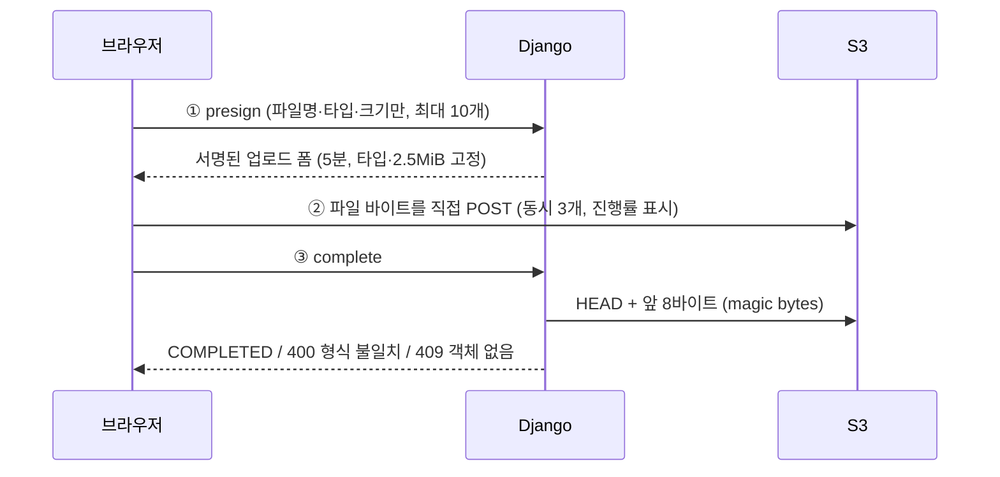
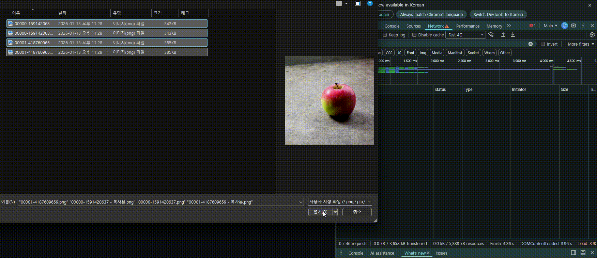

# image-upload-with-django

로그인한 사용자가 PNG·JPEG 이미지를 여러 장 S3에 올리고, 업로드 1년 후 삭제되는(수동 배치, S3 lifecycle 370일이 안전망) 이미지 업로드 시스템 MVP입니다.

- 브라우저 → S3 직접 업로드(presigned POST)
- Django 경유 다운로드, S3 key·URL 비노출

## 업로드 흐름

이미지 바이트는 Django 미경유. Django는 ① 서명과 ③ 검증만 담당.

- Django 경유 다운로드 → S3 key·URL 클라이언트 비노출
- S3 이벤트·Celery 없는 `/complete` 동기 검증 → 상시 프로세스 없음
- 같은 트랜잭션의 outbox 기록 → MongoDB 장애와 무관한 요청 성공
- 확정 못 받은 PENDING → 24시간 뒤 배치가 같은 검증으로 확정 또는 삭제

| 네트워크·5xx                 | S3 403(폼 만료)      | 타임아웃(S3 30초·API 15초) | 상한    |
| ------------------------ | ----------------- | -------------------- | ----- |
| 1초×2ⁿ jitter 후 같은 단계 재시도 | 대기 후 presign부터 다시 | 재시도 없이 실패, 버튼으로 재시도  | 합산 4회 |

상세: [docs/upload-flow.md](./docs/upload-flow.md)(파일별 시퀀스), [docs/transaction-flows.md](./docs/transaction-flows.md)(트랜잭션 경계)

## 실측으로 확인한 것

외부 동작은 추정 대신 spike·수동 확인으로 실측 후 계약 테스트로 고정.

- `addressing_style="virtual"` 누락 시 presigned POST URL이 전역 엔드포인트 → 307 → CORS 실패 (S3 계약 테스트 7개)
- MSW의 XHR timeout 미구현, 핸들러로 abort 미전달 → `AbortSignal.timeout`으로 타임아웃 구현
- pymongo `timeoutMS` 설정 시 `serverSelectionTimeoutMS` 무시 → 접속 불가 시 5초 후 실패
- Chrome Slow 4G에서 2MB 초과 파일 3장 30.00초 시점 중단 → 동시 3개 기준 회선 상한 약 2.1Mbps 수용

테스트: 백엔드 216개(pytest, moto, 실제 MongoDB), 프론트 91개(Vitest, RTL, MSW)

## 목적

- 과거에 미비했던 아키텍처 재구성
- 서버의 부하를 최소화 하면서 대용량 업로드 + 서버가 통제하는 파일 접근 구조 설계·구현
- 모든 비즈니스 로직의 TDD(Red → Green → Refactor) 작성 연습
- React + TypeScript와 MongoDB의 실제 기능 적용

## 스택

| 영역       | 기술                                                             |
| -------- | -------------------------------------------------------------- |
| Backend  | Django 5.2 LTS, Django REST Framework, uv                      |
| Database | PostgreSQL, MongoDB(활동 로그)                                     |
| Frontend | React, TypeScript, Vite, TanStack Query, axios                 |
| Storage  | AWS S3 (boto3)                                                 |
| Infra    | Terraform, Docker Compose(로컬 DB)                               |
| Test     | pytest, moto, time-machine, Vitest, React Testing Library, MSW |

