# 트랜잭션 흐름

도메인별 처리 순서와 Postgres 트랜잭션 경계를 그립니다. 규칙과 근거는 ADR-013 "트랜잭션 규칙"과 ADR-005·008에 있습니다.

- 파란 상자 하나가 `transaction.atomic()` 하나입니다. 상자 밖의 Postgres 쿼리는 각각 autocommit입니다.
- S3 호출은 언제나 상자 밖에 있습니다. Mongo 호출은 릴레이에서만 상자 안에 있습니다(규칙 2번의 예외).
- 상태 전환은 조건부 `UPDATE`로 합니다. 반환값이 1일 때만 같은 상자 안에서 `event_outbox`를 기록합니다.

## 개요

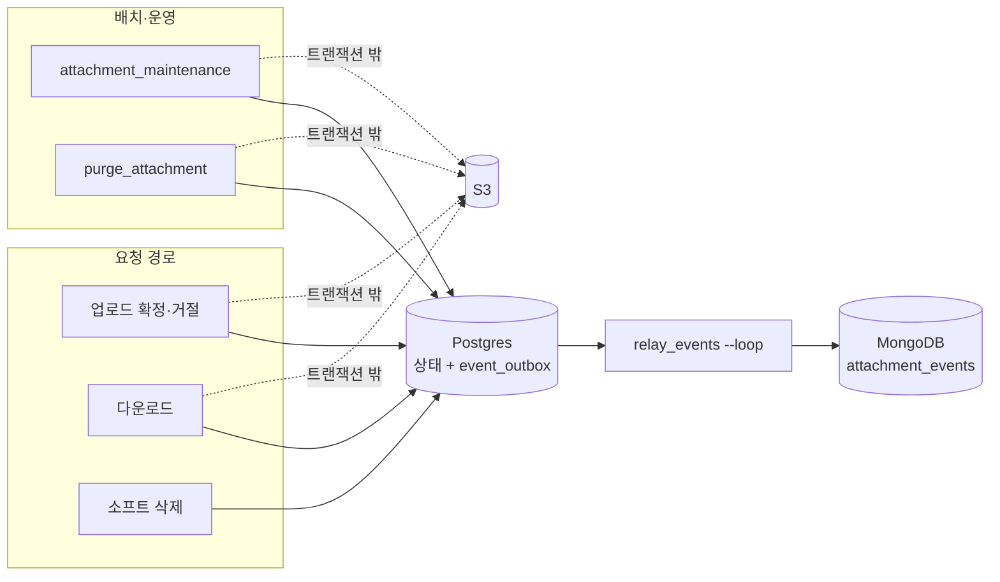

요청 경로는 MongoDB를 직접 부르지 않습니다. 이벤트는 Postgres `event_outbox`를 거쳐 릴레이만 MongoDB로 옮깁니다.

---

## 1. 업로드

### 1-1. presign 발급

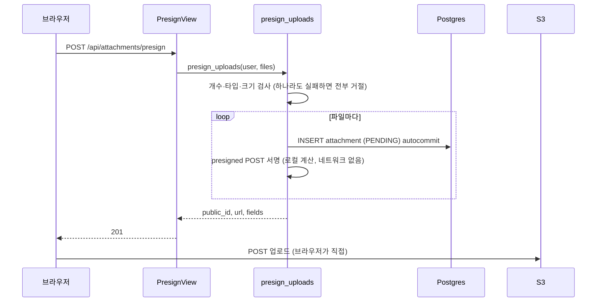

이벤트는 기록하지 않습니다. 업로드 결과는 `/complete`에서 정해집니다.

### 1-2. `/complete` 확정·거절

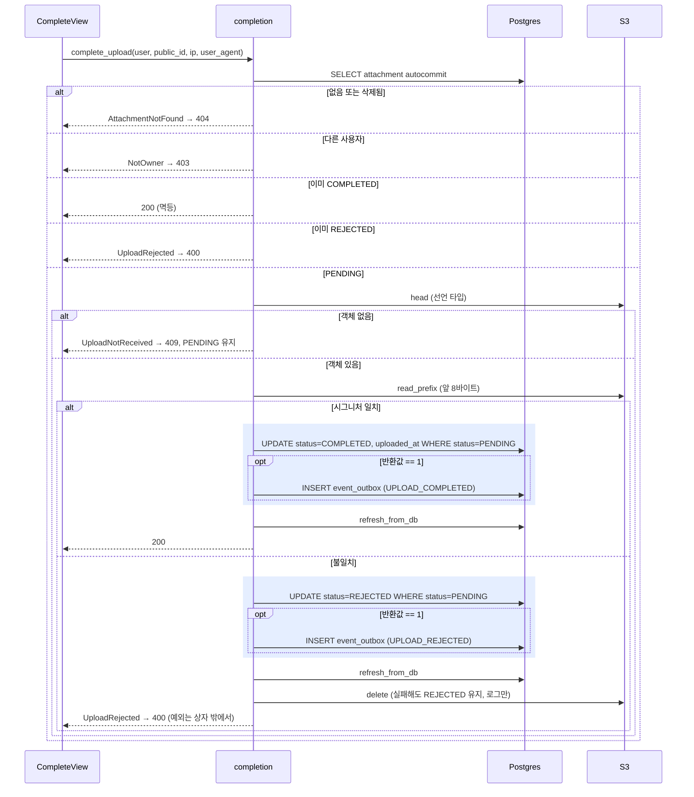

### 1-3. 동시 `/complete` (경쟁)

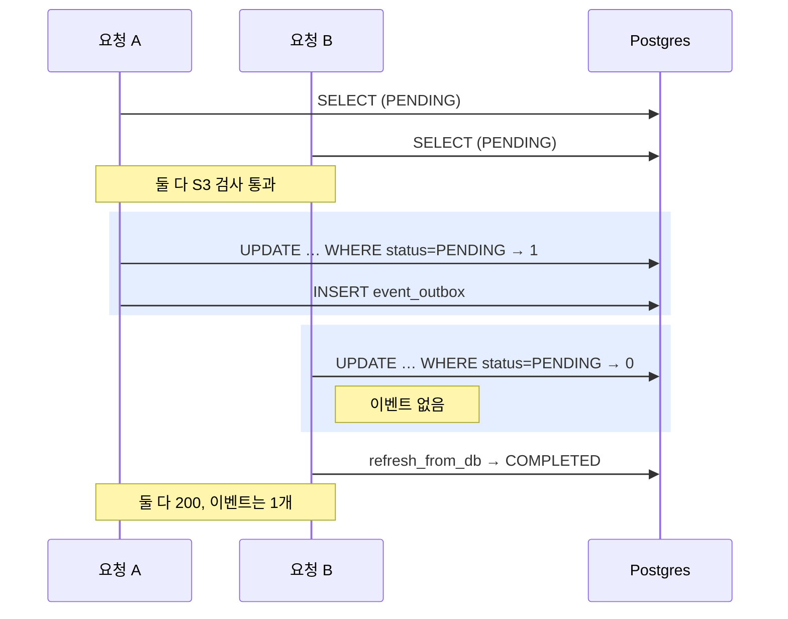

### 1-4. 배치 확정 (24시간 지난 PENDING)

`attachment_maintenance`가 1-2의 PENDING 분기와 같은 `finalize_pending`을 호출합니다. 다음이 다릅니다.

- `ip`·`user_agent`는 null입니다.
- `uploaded_at`과 이벤트 시각은 배치를 시작할 때 구한 시각입니다.
- 객체가 없으면 하드 삭제(3-2)로 넘어갑니다. 거절된 행은 같은 실행의 REJECTED 정리 단계에서 하드 삭제됩니다.

---

## 2. 다운로드

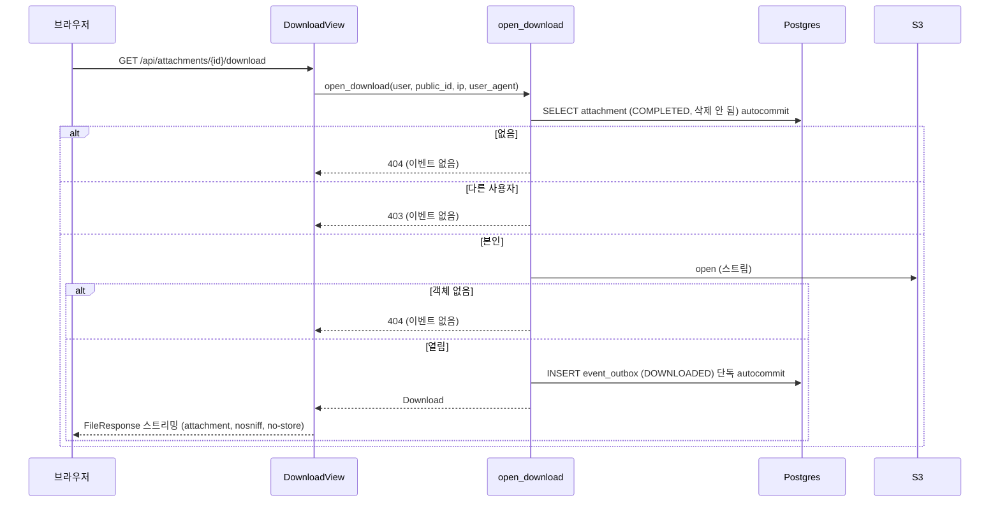

`DOWNLOADED`는 "응답을 시작했다"는 뜻입니다. 전송 완료까지 보장하지는 않습니다.

---

## 3. 삭제

### 3-1. 소프트 삭제

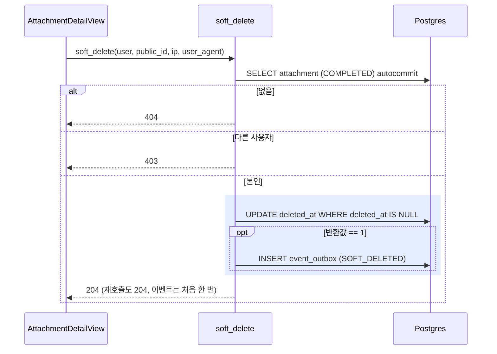

S3는 건드리지 않습니다. 30일 뒤 배치가 하드 삭제합니다.

### 3-2. 하드 삭제 (`purge`, 배치·운영 공통)

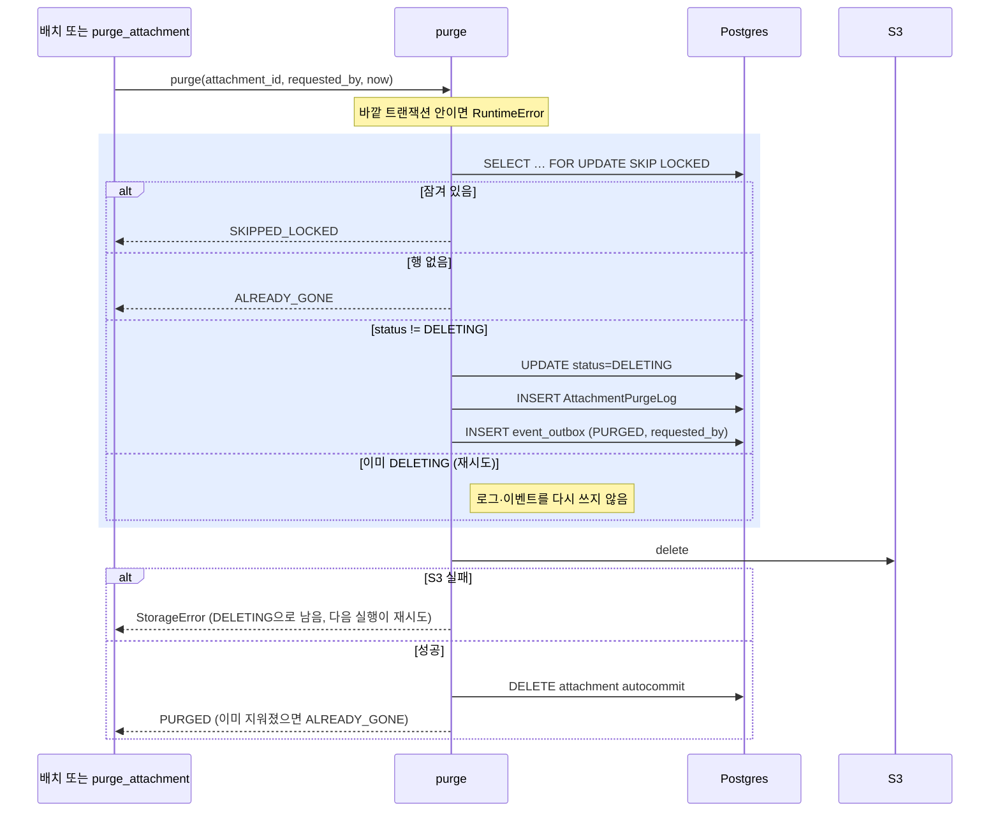

- **운영 삭제 (`purge_attachment --public-id --operator`):** `purge_by_operator`가 운영자(활성 사용자)와 첨부를 조회한 뒤 `purge(requested_by=운영자)`를 호출합니다. `requested_by`는 감사 로그와 `PURGED` 이벤트에 운영자 id로 들어갑니다.
- **배치 삭제:** `requested_by`는 null이고, `now`는 배치를 시작할 때 구한 시각입니다.

---

## 4. 이벤트 발행

### 4-1. 릴레이 (`relay_events`)

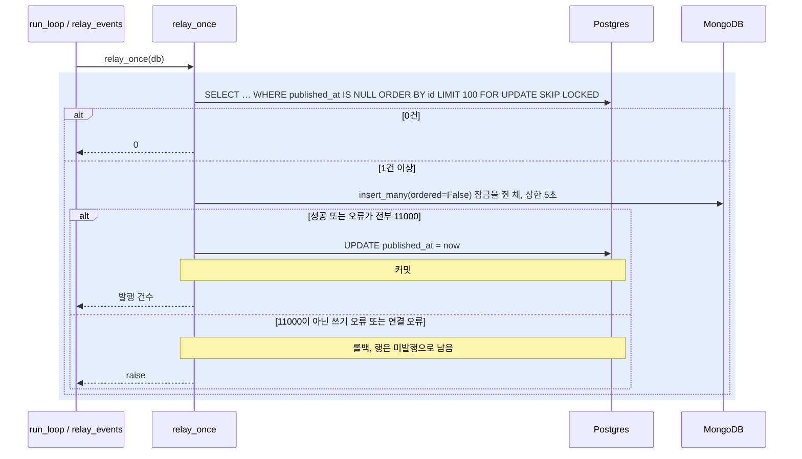

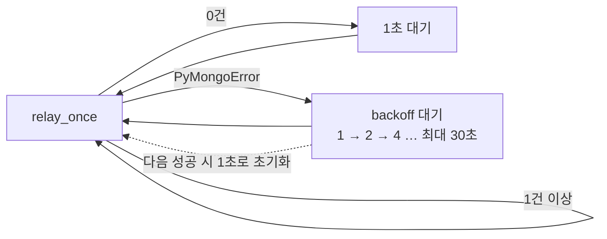

- **`--loop` 없음:** 한 번 실행하고 `published=N`을 출력합니다. Mongo가 실패하면 `CommandError`(exit 1)로 끝납니다.
- **동시 실행:** 릴레이를 여러 개 띄워도 `SKIP LOCKED` 때문에 같은 행을 잡지 않습니다.
- **at-least-once:** 커밋 직전에 죽으면 같은 이벤트가 다시 전송되고, Mongo `event_id` unique 인덱스가 중복을 흡수합니다.

### 4-2. 아웃박스 정리

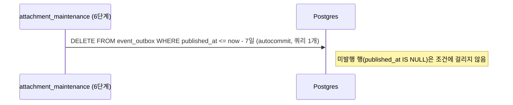

---

## 부록: `attachment_maintenance` 실행 순서

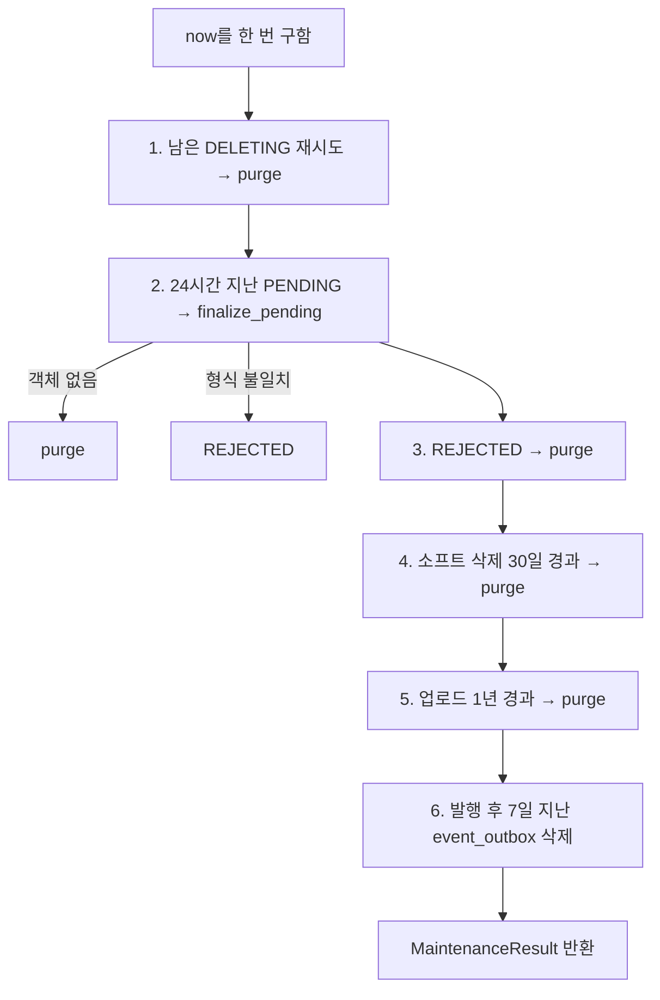

각 단계는 잠금 없이 대상 id만 고르고, 잠금은 `purge()`가 겁니다. 한 실행에서 실패해 DELETING으로 남은 행은 다음 실행의 1단계가 처리합니다.
