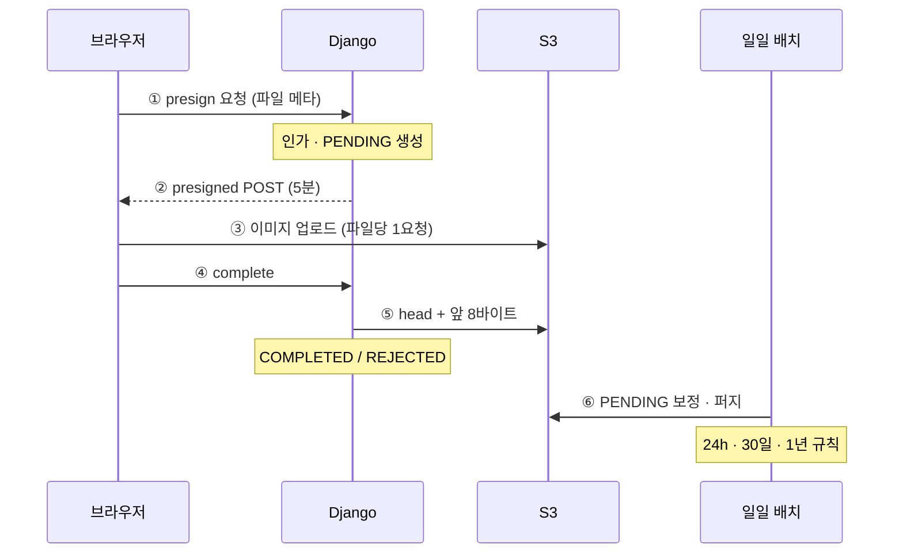
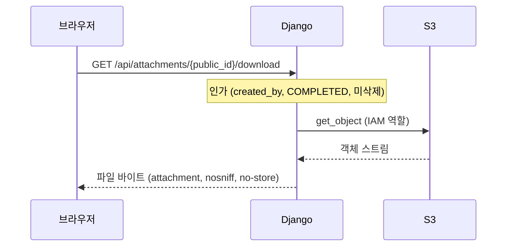

# 이미지 업로드 시스템 — ADR

- 작성일: 2026-10-11
- 범위: MVP 사이드 프로젝트
- 구현 순서와 작업 목록: [`image-upload-roadmap.md`](./image-upload-roadmap.md)

---

## 개요

로그인한 사용자가 PNG·JPEG 이미지를 여러 장 S3에 올리고, 1년 동안 보관한 뒤 자동 삭제하는 MVP입니다.

- **업로드:** 이미지 바이트는 Django를 거치지 않고 브라우저에서 S3로 직접 올라갑니다.
- **다운로드:** 파일은 Django를 거쳐서만 내려갑니다. 클라이언트에는 S3 key도 URL도 노출하지 않습니다.
- **실행 환경:** MVP는 로컬 개발 전용입니다. AWS에는 S3 버킷, 로컬 개발용 IAM, 비용 알림만 둡니다(ADR-014). 배포 관련 결정은 보류 상태입니다.

### MVP 원칙

- 부모 문서(전표) 없음, 썸네일 없음, 화면 미리보기 없음, 서버 측 이미지 변환·압축 없음
- 필요한 것만 저장합니다.
- 외부 동작은 계약 테스트로 확인합니다.
- 모든 비즈니스 로직은 TDD(Red → Green → Refactor)로만 추가합니다.

### 결정 요약

| 영역 | 결정 | ADR |
| --- | --- | --- |
| 업로드 | presigned POST로 S3 직접 업로드, 파일당 1요청, 동시성 3~4 | 001 |
| 검증 | PNG·JPEG만, 2.5MB 상한(S3 조건), 앞 8바이트 magic bytes 검사 | 002 |
| 상태 확정 | `/complete` 동기 검증 + 주기 배치 보정, S3 이벤트 파이프라인 없음 | 003 |
| 데이터 모델 | `Attachment` + `AttachmentPurgeLog`, 시간은 UTC 고정 | 004 |
| 삭제·보존 | 사용자 소프트 삭제 → 30일 후 하드 삭제, 업로드 1년 후 하드 삭제, 운영 삭제는 command | 005 |
| 보안 | 어디서든 접속 → 업로더 본인 인가 + 짧은 업로드 URL 만료 + Block Public Access + TLS 강제 | 006 |
| 스택 | React+TS+Vite / Django 5.2 LTS+DRF / PostgreSQL, 세션 인증(same-origin) | 007 |
| 배치 | `manage.py attachment_maintenance` 하나로 묶음. 로컬은 수동 실행, 스케줄러는 보류 | 008 |
| 인프라 | Terraform으로 S3·IAM·Budgets만 관리, 배포 인프라는 보류 | 009 |
| 테스트 | Red-Green-Refactor 강제, 테스트 없는 비즈니스 로직 금지, S3 계약 테스트 | 010 |
| 컨테이너 | 로컬은 Postgres만 compose, 배포는 Django 이미지 하나 | 011 |
| 파일 제공 | presigned GET 미사용, Django가 S3에서 읽어 스트리밍, key·URL 비노출 | 012 |
| 활동 로그 | MongoDB에 이벤트 5종 + IP 기록, Postgres 아웃박스 → 릴레이, TTL 400일, 통계 API | 013 |
| 비용 | 로컬 개발 전용. AWS는 S3·IAM·Budgets만, 시간 과금 리소스 금지, 월 $1 미만 | 014 |
| 백엔드 계층 | views → services → selectors → storage·events → models, import-linter로 검사 | 015 |

### 전체 흐름

업로드 경로:



③만 이미지 바이트가 지나가는 경로입니다. 브라우저가 ④를 보내지 못하면 ⑥ 배치가 대신 확정합니다.

다운로드 경로:



---

## ADR-001 업로드 방식: presigned POST 직접 업로드

- **상태:** 승인

### 결정

브라우저가 Django에서 presigned POST를 받아 S3로 직접 업로드합니다. Django는 업로드 바이트를 받지 않습니다.

### 컨텍스트

- 여러 장의 이미지를 올려야 합니다.
- Django(sync, gunicorn)가 대용량 요청 본문을 받으면 워커가 묶입니다.
- S3 API는 한 요청에 객체 하나만 올릴 수 있습니다.

### 세부 결정

- **presign은 배치로 발급합니다.** 요청당 최대 10개, 만료 5분입니다. 큐가 길면 청크 단위로 그때그때 받습니다(2026-10-13 결정).
  - 요청: `POST /api/attachments/presign` `{"files": [{"client_ref", "filename", "content_type", "size"}]}`
  - 응답: 201 `{"uploads": [{"client_ref", "public_id", "url", "fields"}]}`. `client_ref`는 클라이언트가 파일을 짝짓는 값으로, 그대로 돌려주기만 하고 DB에 저장하지 않습니다.
  - 한 파일이라도 규칙(개수·MIME·크기·파일명)을 어기면 요청 전체가 400이고 DB 행을 만들지 않습니다.
- **presigned PUT이 아닌 POST를 씁니다.** 정책에 `content-length-range`, `Content-Type`, `key`를 고정할 수 있기 때문입니다.
- **업로드는 파일당 1요청이고, 동시성 풀로 3~4개씩 병렬 전송합니다.** S3는 HTTP/1.1이라 브라우저가 host당 6개 연결로 큐잉하므로, 그 이상 늘리는 건 의미가 없습니다.
- **재시도 규칙:**
  - 403 → presign 재발급 후 재시도
  - 400 → 중단(정책 위반)
  - 5xx·네트워크 오류 → 지수 backoff + jitter, 최대 4회
- **업로드 HTTP는 XHR 기반(axios `onUploadProgress`)을 씁니다.** 진행률이 필요하기 때문입니다.
- **boto3 클라이언트는 `region_name`, `signature_version="s3v4"`, `s3={"addressing_style": "virtual"}`을 명시합니다.** 빠지면 presigned POST URL이 전역 엔드포인트(`<bucket>.s3.amazonaws.com`)로 생성되고, S3가 307 리다이렉트를 돌려주며, 브라우저가 CORS 요청에서 이를 따라가지 못해 업로드가 깨집니다.
  - 0-3 spike(2026-10-12, botocore 1.43.111): region과 s3v4만 지정해도 URL이 전역 엔드포인트로 나와 307이 났습니다. `addressing_style="virtual"`을 더하면 `<bucket>.s3.ap-northeast-2.amazonaws.com`이 나오고 204로 성공했습니다.
- **presign 응답의 S3 엔드포인트와 폼 필드는 업로드에만 쓰이는 쓰기 전용 정보입니다.** 파일을 읽는 URL은 어떤 응답에도 포함하지 않습니다(ADR-012).

### 고려한 대안

| 대안 | 기각 이유 |
| --- | --- |
| Django가 받아서 boto3로 업로드 | 전송 2회, 워커 묶임, 임시 저장소 필요 |
| Celery가 비동기로 S3 업로드 | 메시지에 바이트를 실을 수 없어 공유 스토리지(EFS 등)가 필요 |
| zip으로 묶어 1요청 | 압축 해제용 컴퓨팅 필요, 부분 실패 시 전체 재전송, 파일별 상태 추적 불가 |
| `Promise.all` 무제한 병렬 | 브라우저 큐 대기 중 URL 만료, 첫 실패에서 결과 유실 |

### 결과

- 업로드 경로의 서버 부하는 서명 연산(로컬 HMAC)뿐입니다.
- 대신 브라우저 쪽 업로드 큐 구현과 버킷 CORS 설정이 필요합니다.

---

## ADR-002 파일 검증: S3 POST 조건 + magic bytes

- **상태:** 승인

### 결정

- PNG·JPEG만 받고, 크기 상한은 2.5MiB(2,621,440바이트, 이하 허용)입니다.
- 크기와 선언 타입은 S3가 POST 정책으로 강제합니다.
- 실제 포맷은 `/complete`에서 앞 8바이트로 확인합니다.
- 확장자는 신뢰하지 않습니다.

### 세부 결정

- **허용 MIME:** `image/png`, `image/jpeg`(jpg와 jpeg는 같은 포맷). HEIC, SVG 등은 presign 단계에서 400입니다.
- **크기:** 프론트가 presign 요청 전에 거부하고, S3 `content-length-range`가 최종 강제합니다. 정확한 바이트 값은 미결 사항입니다.
- **압축은 사용자가 직접 합니다.** 서버와 브라우저 모두 재인코딩하지 않으므로 원본이 그대로 보존됩니다.
- **magic bytes:** Range GET `bytes=0-7`로 읽습니다.
  - PNG: `89 50 4E 47 0D 0A 1A 0A`
  - JPEG: `FF D8 FF`
  - 불일치 → `REJECTED` + 객체 삭제
- **S3 key의 확장자는 서버가 정합니다.** 선언 MIME에 따라 `.png` 또는 `.jpg`를 붙입니다. 원본 파일명은 DB에만 저장합니다.
- **아이폰 사진:** HEIC 포맷은 허용 목록으로 막힙니다. iOS가 업로드 시 JPEG로 자동 변환한 사진은 정상 JPEG로 통과합니다.

### 한계

- magic bytes 검사는 헤더만 봅니다. 헤더는 정상이고 뒤가 손상된 파일은 통과합니다.
- 서버가 이미지를 디코딩하지 않고, 다운로드도 attachment로만 제공하므로(ADR-012) MVP에서는 수용합니다.

### 결과

서버 측 이미지 처리 라이브러리(Pillow 등)가 필요 없습니다.

**검증 (0-3, 2026-10-12):** 실제 dev 버킷에서 2,621,440바이트는 204, 1바이트 초과는 400 `EntityTooLarge`, Content-Type 불일치는 403 `Policy Condition failed`입니다. 계약 테스트: [`backend/tests/s3_contract/test_s3_presigned_post.py`](./backend/tests/s3_contract/test_s3_presigned_post.py) `test_s3_rejects_body_over_size_limit`, `test_s3_rejects_mismatched_content_type`.

---

## ADR-003 상태 확정: /complete 동기 검증 + 주기 보정

- **상태:** 승인

### 결정

- 업로드를 마친 브라우저가 `/complete`를 호출하면, Django가 동기로 검증해 상태를 확정합니다.
- 브라우저가 호출하지 못한 경우는 주기 배치가 보정합니다.
- S3 이벤트 → SQS → 워커 파이프라인은 두지 않습니다.

### 컨텍스트

썸네일이 없어서 후처리가 "포맷 검증 + 상태 확정"뿐입니다. 이 정도 일에 SQS, S3 알림, 소비자 프로세스를 두면 운영 부담만 늘어납니다.

### 상태 전이

1. presign 발급 → `PENDING` (`created_at` 기록)
2. `/complete`: `head_object`로 존재 확인 → Range GET 8바이트 검사
   1. 통과 → `COMPLETED` (`uploaded_at` 기록)
   2. 불일치 → `REJECTED` + 객체 삭제
   3. 객체 없음 → 409, `PENDING` 유지
3. 이미 `COMPLETED`인 첨부에 대한 재호출 → 200 (멱등)
4. 배치: 24시간 넘은 `PENDING` → `head_object`로 같은 검증 수행, 객체가 없으면 하드 삭제 경로로

### `/complete` 응답 (2026-10-13 결정)

| 상황 | 응답 |
| --- | --- |
| 통과(`COMPLETED`), 재호출 포함 | 200 `{"public_id", "status": "COMPLETED"}` |
| 시그니처 불일치·8바이트 미만·선언 타입과 실제 포맷 불일치(`REJECTED`), 재호출 포함 | 400 `{"detail": "invalid_format"}` |
| 객체 없음 | 409, `PENDING` 유지. S3는 쓰기 직후 읽기가 일관되므로 업로드 실패를 뜻하며, 프론트는 "재업로드 필요(retryable)"로 분류 |
| 다른 사용자의 첨부 | 403 |
| 없는 `public_id`, 소프트 삭제·`DELETING` | 404 |

- **선언 타입:** `head_object`의 Content-Type(POST 정책으로 고정된 값)으로 읽습니다. 모델에 컬럼을 두지 않습니다. 실제 포맷이 선언 타입과 다르면 PNG·JPEG라도 `REJECTED`입니다.
- **거절 시 S3 삭제 실패:** `REJECTED`와 400은 그대로 두고 경고 로그만 남깁니다. 남은 객체는 일일 배치의 `REJECTED` 정리가 지웁니다.
- **동시 호출:** 결과가 같아 MVP는 잠금 없이 둡니다. 이벤트 기록(1-19)은 `filter(status=PENDING).update(...)`의 반환값이 1일 때만 기록하는 조건부 갱신으로 중복을 막습니다.

### 고려한 대안

S3 Event Notifications → SQS → Lambda, 또는 브리지 프로세스 + Celery.

- **장점:** 탭을 닫아도 수 초 안에 확정됩니다.
- **단점:** at-least-once 중복 처리, URL 인코딩된 key 처리, SQS 접근 정책, 소비자 프로세스 운영이 따라옵니다.

첨부 확정이 수십 분 늦어져도 문제가 없으므로 기각했습니다.

### 결과

- 진실의 원천은 S3 객체와 서버 검증입니다.
- 클라이언트의 `/complete`는 확정을 앞당기는 트리거일 뿐, 신뢰 대상이 아닙니다.

---

## ADR-004 데이터 모델

- **상태:** 승인

### 결정

- 테이블은 `Attachment`와 `AttachmentPurgeLog` 두 개입니다.
- 이미지는 업로드한 사용자(`created_by`)에게만 속하며, 부모 문서는 두지 않습니다.
- 모든 시간은 UTC로 고정합니다.

### 시간 규칙

- `TIME_ZONE="UTC"`, `USE_TZ=True`, 컬럼 타입은 `timestamptz`입니다.
- API는 ISO 8601 UTC(`...Z`)로 응답합니다.
- 시각은 전부 서버가 찍습니다. 클라이언트가 보낸 시각은 쓰지 않습니다.

### 모델

```python
class Attachment(models.Model):
    class Status(models.TextChoices):
        PENDING = "PENDING"
        COMPLETED = "COMPLETED"
        REJECTED = "REJECTED"
        DELETING = "DELETING"

    public_id = models.UUIDField(default=uuid4, unique=True, editable=False)  # API 노출용 유일 식별자
    created_by = models.ForeignKey(User, on_delete=models.PROTECT, related_name="attachments")
    s3_key = models.CharField(max_length=512, unique=True)   # 내부 전용, API 응답에 포함 금지
    original_filename = models.CharField(max_length=255)      # 다운로드 Content-Disposition용
    status = models.CharField(max_length=16, choices=Status.choices, default=Status.PENDING)

    created_at = models.DateTimeField(auto_now_add=True)  # presign 발급 → 24h PENDING 정리 기준
    uploaded_at = models.DateTimeField(null=True)          # 검증 통과 → 1년 만료 기준
    deleted_at = models.DateTimeField(null=True)           # 소프트 삭제 → 30일 퍼지 기준


class AttachmentPurgeLog(models.Model):     # 하드 삭제 감사 로그, FK 없이 값 복사
    attachment_public_id = models.UUIDField()
    created_by_id = models.BigIntegerField()
    s3_key = models.CharField(max_length=512)
    original_filename = models.CharField(max_length=255)
    uploaded_at = models.DateTimeField(null=True)
    deleted_at = models.DateTimeField(null=True)
    requested_by_id = models.BigIntegerField(null=True)  # 운영자, 시스템 배치면 null
    purged_at = models.DateTimeField(auto_now_add=True)
```

- **`purged_at`의 의미 (2026-10-13 결정):** 실제로 파일이 지워진 시각이 아니라 **하드 삭제를 시작한 시각**(`DELETING` 전환 시각)입니다. 로그는 S3 삭제 전에 남기므로, S3 삭제가 계속 실패하면 로그는 있지만 파일과 `DELETING` 행은 남아 있습니다. 남은 건수는 배치 실행 결과(`DELETING` 잔량)로 확인합니다(ADR-008).

- **S3 key 형식:** `attachments/{user_id}/{uuid}.{png|jpg}`
- **버킷 이름:** settings에 둡니다.

### 인덱스 (Postgres partial index)

| 이름 | 컬럼 | 조건 | 쓰는 곳 |
| --- | --- | --- | --- |
| `att_pending_idx` | `created_at` | `status='PENDING'` | 24h PENDING 정리 |
| `att_softdel_idx` | `deleted_at` | `deleted_at IS NOT NULL` | 30일 퍼지 |
| `att_expire_idx` | `uploaded_at` | `status='COMPLETED'` | 1년 만료 |
| `att_list_idx` | `created_by, uploaded_at` | `status='COMPLETED' AND deleted_at IS NULL` | 내 첨부 목록 |

### 내 목록 API (2026-10-13 결정)

- `GET /api/attachments`: 본인의 `COMPLETED`이면서 소프트 삭제되지 않은 첨부만 반환합니다.
- **커서 페이지네이션**(DRF `CursorPagination`), 페이지당 50개(추정 값), 정렬 `-uploaded_at, -id`. 응답은 `{"next", "previous", "results": [{"public_id", "original_filename", "uploaded_at"}]}`입니다.
  - 선택 이유는 성능이 아니라 화면("더 보기")과 응답 모양 고정입니다. 넘기는 중 업로드·삭제가 있어도 중복·누락이 없습니다.
  - `id` 2차 정렬은 `uploaded_at`이 같은 행이 페이지 경계에서 빠지지 않게 합니다.
- `uploaded_at`은 UTC ISO 8601로 줍니다. 화면 표시 방식은 미결 사항입니다.

### CHECK 제약

- `status='COMPLETED'`이면 `uploaded_at`이 반드시 있다.
- `deleted_at`은 `COMPLETED` 또는 `DELETING` 상태에서만 있다.

### 의도적으로 뺀 필드

| 필드 | 빼도 되는 이유 |
| --- | --- |
| 부모 문서(전표) | MVP 범위 밖 |
| `content_type` | key 확장자와 S3 객체 메타로 충분 |
| `size_bytes` | S3 조건이 상한을 강제 |
| `reject_reason` | MVP에서 사유 표시 불필요 |
| `deleted_by` | 삭제자는 항상 업로더 |
| `purge_requested_at` | 배치가 남은 `DELETING`을 매번 재시도 |
| 감사 로그의 삭제 사유 | MVP 범위 밖 |

감사 로그에 삭제 사유가 없으므로, 만료 삭제와 소프트 삭제 후 퍼지는 구분할 수 없습니다. 운영 삭제인지 시스템 삭제인지는 `requested_by_id`의 null 여부로만 구분합니다.

### 결과

- 소프트 삭제는 상태값이 아니라 `deleted_at`으로 표현합니다.
- 상태(파일이 어디까지 처리됐는가)와 가시성(사용자에게 보이는가)을 분리해서, 상태 전이를 단순하게 유지합니다.

---

## ADR-005 삭제·보존

- **상태:** 승인

### 결정

- 보존 기간은 업로드 후 1년입니다.
- 사용자는 본인이 올린 이미지만 소프트 삭제할 수 있고, 소프트 삭제 30일 후 시스템이 하드 삭제합니다.
- 하드 삭제는 DB를 기준으로 하며, S3 Lifecycle은 안전망입니다.

| 주체 | 방식 | 경로 | 효과 |
| --- | --- | --- | --- |
| 사용자(업로더 본인) | 소프트 삭제 | 앱 API | `deleted_at` 기록, 목록·다운로드에서 즉시 제외, S3 호출 없음 |
| 시스템 | 하드 삭제 | 일일 배치 | 소프트 삭제 30일 경과, 업로드 1년 경과, `PENDING` 24h, `REJECTED` 정리 |
| 인프라·개발자 | 하드 삭제 | `manage.py purge_attachment --public-id <uuid> --operator <username>` | 즉시 하드 삭제, 감사 로그에 `requested_by_id` 기록 |
| 인프라(비상시) | 콘솔 직접 삭제 | break-glass IAM 역할 | DB는 그대로 → 다운로드 시 객체 없음으로 처리 |

### 삭제 API (2026-10-13 결정)

`DELETE /api/attachments/{public_id}`. 판정은 위에서부터 순서대로 합니다.

| 상황 | 응답 |
| --- | --- |
| 없는 id, `COMPLETED`가 아닌 첨부(`PENDING`·`REJECTED`·`DELETING`) | 404 |
| 타인 첨부(이미 소프트 삭제된 것 포함) | 403 |
| 본인 첨부 | 204 (본문 없음) |
| 본인 첨부 재호출(이미 소프트 삭제됨) | 204, `deleted_at`은 최초 값 유지 |

- `deleted_at`을 덮어쓰면 재호출마다 30일 퍼지 타이머가 다시 시작됩니다. 그래서 `filter(deleted_at__isnull=True).update()`로 한 번만 기록합니다. 동시 요청에도 한 번만 기록되고, 이벤트는 반환값이 1일 때만 남깁니다(1-19).
- 미완료 첨부는 목록·다운로드에 보이지 않으므로 사용자에게는 없는 것과 같습니다. 정리는 배치가 합니다.

### 하드 삭제 순서

1. `DELETING` 전환 + 감사 로그 기록
2. S3 `delete_object`
3. DB 행 삭제

S3 삭제가 실패해도 `DELETING` 행이 남아 있어서 다음 배치가 재시도합니다.

**서비스 계약 (2026-10-13 결정, 2026-10-14 반환값 보완):** `purge(attachment_id, *, gateway, requested_by=None) -> PurgeOutcome`

| 반환값 | 뜻 |
| --- | --- |
| `PURGED` | 3단계 행 삭제가 1건을 지웠을 때만. 이번 호출이 실제로 행을 지웠습니다 |
| `ALREADY_GONE` | 1단계에서 행이 없음(잠금 없는 `exists()`로 확인), 또는 3단계 행 삭제가 0건(다른 실행이 먼저 지움) |
| `SKIPPED_LOCKED` | 행은 있지만(`exists()` True) 다른 실행이 잠그고 있어 `select_for_update(skip_locked=True)`가 행을 주지 않음 |

- **보완 이유 (2026-10-14):** 1단계 커밋 뒤 잠금이 풀리므로, 두 실행이 같은 행의 2·3단계를 함께 진행할 수 있습니다. 데이터는 멱등이라 안전하지만, 둘 다 "삭제함"을 반환하면 배치 집계가 실제 삭제 건수보다 커집니다(1-10 동시 실행 테스트에서 20건에 21로 재현). 그래서 "삭제함"은 실제로 행을 지운 호출 하나에만 돌려줍니다.
- 배치(ADR-008)는 `PURGED`를 `purged`로, 나머지 둘을 `skipped`로 셉니다.

- **트랜잭션 경계:** 1단계만 짧은 트랜잭션으로 먼저 커밋하고, 2·3단계는 그 밖에서 실행합니다. 셋을 한 트랜잭션으로 묶으면 S3 삭제 뒤 3단계가 실패할 때 1단계까지 롤백되어, 파일은 없는데 행은 원래 상태로 남고 로그도 사라집니다.
- **바깥 트랜잭션 금지:** 바깥 `atomic` 안에서 호출되면 `RuntimeError`입니다. 바깥 트랜잭션이 1단계 커밋을 붙잡아 위 경계가 무너지기 때문입니다.
- **잠금:** 1단계에서 `select_for_update(skip_locked=True)`로 행을 다시 읽습니다. 행이 없거나 다른 실행이 잠그고 있으면 건너뜁니다.
- **재시도:** 이미 `DELETING`인 행이면 로그를 다시 남기지 않고 2·3단계만 실행합니다. 감사 로그는 첨부당 1건입니다.
- **실패:** S3 삭제 실패는 `StorageError`를 그대로 던집니다. 배치는 그 행을 실패로 세고 다음 행으로 넘어가며, 운영 명령은 실패로 종료합니다.
- **운영 삭제:** `requested_by`에 운영자를 넘기면 감사 로그의 `requested_by_id`에 기록됩니다. 시스템 배치는 null입니다.

- **멱등성:** `delete_object`는 없는 key에도 204를 돌려주므로, 재시도해도 안전합니다.
- **배치 삭제:** 배치도 key마다 `delete_object`를 호출합니다. 실패한 key의 행만 `DELETING`으로 남고 다음 배치가 재시도합니다. (2026-10-12 결정: MVP 규모에서 `delete_objects` 묶음 삭제와 1,000개 분할은 불필요. DELETE 요청은 무료)

**운영 명령 (2026-10-14 결정):** `manage.py purge_attachment --public-id <uuid> --operator <username>`

- **식별자:** 운영자가 API·로그에서 보는 값은 `public_id`뿐이므로 `public_id`를 받고, 명령 안에서 pk로 바꿔 `purge()`를 호출합니다.
- **식별자 형식:** `--public-id`는 argparse `type=uuid.UUID`로 받아, UUID가 아니면 사용법 오류(종료 코드 2)로 끝납니다.
- **운영자:** `--operator`는 필수입니다. 없는 사용자나 `is_active=False` 사용자면 `purge()`를 호출하지 않고 실패합니다. 조회·검증은 서비스 `purge_by_operator(public_id, *, operator_username, gateway)`가 하고(`OperatorNotAllowed`·`AttachmentNotFound`), 명령은 예외를 `CommandError`로 바꿔 출력만 합니다. null은 시스템 삭제를 뜻하므로 운영 삭제에 null을 남기지 않습니다.
- **대상:** 상태(`PENDING`·`REJECTED`·소프트 삭제 포함)를 가리지 않고 즉시 하드 삭제합니다. 확인 프롬프트는 두지 않습니다(UUID라 오타가 다른 첨부와 일치할 가능성이 매우 낮음).

| 상황 | 종료 | 출력 |
| --- | --- | --- |
| `PURGED` | 0 | 삭제함 |
| `ALREADY_GONE`(조회 뒤 다른 실행이 먼저 지움) | 0 | 이미 삭제됨 (`PURGED`와 구분) |
| 없는 `public_id` | `CommandError` | `purge()` 호출 전 판정 |
| `SKIPPED_LOCKED` | `CommandError` | 처리 중, 다시 시도 |
| `StorageError`·`StorageAuthError` | `CommandError` | 행은 `DELETING`으로 남고 배치가 재시도 |

### 동시성

배치는 잠금 없이 대상 id만 고르고, 행마다 `purge()`를 호출합니다. `purge()`가 1단계에서 `select_for_update(skip_locked=True)`로 행을 다시 읽어 잠그므로, 두 실행이 겹쳐도 같은 행의 1단계(전환·로그)를 중복 처리하지 않습니다. 잠긴 행과 이미 사라진 행은 건너뜁니다. 1단계가 커밋된 뒤 2·3단계가 겹치더라도 `delete_object`와 행 삭제가 멱등이라 안전합니다. (2026-10-13 수정)

### S3 설정

- **Versioning 꺼짐:** 켜져 있으면 삭제가 delete marker만 남겨서 하드 삭제가 되지 않습니다.
- **Lifecycle Expiration 370일**(prefix `attachments/`): 배치가 놓친 고아 객체를 지우는 안전망입니다.
- **Lifecycle `AbortIncompleteMultipartUpload` 1일:** 비용이 들지 않으므로 걸어둡니다.

### 고려한 대안

| 대안 | 기각 이유 |
| --- | --- |
| 사용자 하드 삭제 | 복구 불가, 사용자 경로에서 S3 호출 필요 |
| 소프트 삭제를 1년 만료 때 함께 삭제 | 사용자가 지운 파일이 최대 1년 남음 |
| S3 Lifecycle만으로 만료 | DB와 불일치 구간 발생, 실제 삭제 지연 |

---

## ADR-006 접근 제어·보안

- **상태:** 승인

### 결정

- 사용자는 어디서든 접속하므로, 네트워크로 버킷을 막지 않습니다.
- 대신 Django 인가, 짧은 업로드 URL 만료, 버킷 정책으로 방어합니다.
- 파일 읽기는 Django를 통해서만 가능합니다(ADR-012).

### 컨텍스트

- presigned URL은 bearer 토큰이라서, 유출되면 만료 전까지 누구나 쓸 수 있습니다.
- 사용자 브라우저가 VPC 밖에 있어서 `aws:SourceVpce`·`aws:SourceIp` 제한을 쓸 수 없습니다.

### 방어선

- **인가:** presign, complete, 삭제, 다운로드 모두 DB의 `created_by`와 로그인 사용자를 비교합니다. 클라이언트가 보낸 값이나 S3 메타데이터로는 판정하지 않습니다.
- **만료:** 업로드 URL은 5분입니다. 읽기용 presigned URL은 발급하지 않습니다.
- **POST 정책:** `key` 정확 일치, `Content-Type`, `content-length-range`를 고정합니다.
- **버킷:**
  - Block Public Access 전체 켜짐
  - ACL 비활성(Bucket owner enforced)
  - `aws:SecureTransport=false`인 요청 Deny
- **남용 제한:** 요청당 최대 10개, 사용자별 presign 발급 60회/시간(DRF `ScopedRateThrottle` scope `presign`, `DatabaseCache`). 2026-10-13 결정.
- **비노출:** API 응답에 `s3_key`, 버킷 이름, S3 도메인을 포함하지 않습니다. 식별자는 `public_id`만 씁니다.
  - 예외는 presign 응답의 업로드 폼 하나뿐입니다(ADR-012).
- **CORS:** 프론트 origin만 허용합니다(로컬은 `http://localhost:5173`). 브라우저만 지키는 규칙이므로 보안 장치로 보지 않습니다.
- **보안 로그:** 업로드·다운로드·삭제 이벤트를 클라이언트 IP와 함께 MongoDB에 기록합니다(ADR-013).
  - IP는 신뢰하는 프록시 홉 수 기준으로 추출합니다.
  - 사용자 API로는 노출하지 않습니다.

### IAM

| 주체 | 권한 |
| --- | --- |
| 앱(ECS 태스크 롤, 로컬은 dev IAM) | 버킷 prefix에 대한 `PutObject`(서명용), `GetObject`, `DeleteObject` + `s3:prefix`로 제한한 `ListBucket`(없는 객체에 403 대신 404를 받기 위함, 0-3 spike) |
| 개발자 기본 계정 | 운영 버킷 `DeleteObject` 없음 |
| break-glass 역할 | 콘솔 직접 삭제, 비상시에만 assume |

### 결과

- URL이 유출되면 최대 5분 동안 그 key 하나에 쓰기만 가능합니다.
- 읽기 경로는 항상 세션 인증과 인가를 거칩니다.

**검증 (0-3, 2026-10-12):** 만료된 POST는 403 `Policy expired`, 다른 key로 업로드는 403, CORS preflight는 `localhost:5173`만 허용(그 밖의 origin은 403), dev 권한의 없는 객체 HeadObject는 404(prefix 제한 `ListBucket` 필요)입니다. 계약 테스트: [`backend/tests/s3_contract/test_s3_presigned_post.py`](./backend/tests/s3_contract/test_s3_presigned_post.py) `test_s3_rejects_expired_post`, `test_s3_cors_preflight_allows_frontend_origin`, `test_s3_head_missing_object_returns_404`.

---

## ADR-007 기술 스택과 인증

- **상태:** 승인
- **보류된 부분:** CloudFront 배포 구성은 보류합니다(ADR-014). 로컬에서는 Vite proxy로 same-origin을 구성합니다.

### 결정

- 프론트: React + TypeScript + Vite
- 백엔드: Django 5.2 LTS + DRF
- DB: PostgreSQL
- 인증: same-origin Django 세션 + CSRF

| 계층 | 선택 | 이유 |
| --- | --- | --- |
| 빌드 | Vite | webpack 직접 설정 대신 표준 도구, CRA는 지원 종료 |
| UI | React + TypeScript | 새로 익혀보려는 프레임워크 |
| 업로드 HTTP | axios | XHR 기반이라 업로드 진행률 지원 |
| 동시성 풀 | 직접 구현(약 20줄) | 학습 목적, 의존성 최소화 |
| 서버 상태 | TanStack Query | presign·complete·목록·삭제 호출과 캐시 무효화 |
| 업로드 큐 상태 | `useReducer` | 파일별 상태 머신에 맞음, 전역 상태 라이브러리 불필요 |
| API | Django 5.2 LTS + DRF | 실무 주력 스택 |
| S3 접근 | boto3 + 얇은 `StorageGateway` | `django-storages`는 서버가 업로드 바이트를 받는 구조용이라 불필요 |
| DB 드라이버 | psycopg 3 | |
| DB | PostgreSQL | partial index, `skip_locked` |
| 패키지 관리 | uv | |
| rate limit 저장소 | Django `DatabaseCache` | 별도 Redis 불필요, presign 빈도가 낮음 |

### 인증 (same-origin)

- **로컬:** Vite dev server의 proxy가 `/api`를 Django로 넘깁니다.
- **배포:** CloudFront 하나에 origin 두 개를 둡니다. SPA는 S3, `/api/*`는 ALB입니다.
- **효과:** 브라우저 입장에서 같은 도메인이라 세션 쿠키가 그대로 동작합니다. JWT, 토큰 갱신, 교차 origin 쿠키 문제를 피합니다.
- **사용자 생성:** Django admin으로 만듭니다.

### 인증 API (2026-10-12 결정)

- **위치:** 별도 `accounts` 앱. view가 `django.contrib.auth`(`authenticate`·`login`·`logout`)를 직접 호출합니다(ADR-015 예외).
- **User 모델:** `accounts.User(AbstractUser)`, 필드 추가 없음. `AUTH_USER_MODEL = "accounts.User"`. 나중에 바꾸면 FK가 걸린 마이그레이션을 모두 다시 짜야 하므로 처음부터 둡니다(Django 문서 "Using a custom user model when starting a project").
- **경로:** 모든 API 경로는 끝 슬래시가 없습니다. `path()`로 명시 등록하고, router를 쓰면 `trailing_slash=False`입니다.

| 메서드·경로 | 성공 | 실패 |
| --- | --- | --- |
| `GET /api/auth/csrf` | 204, `csrftoken` 쿠키 | |
| `POST /api/auth/login` | 200 `{"username"}` | 400 `{"detail": "invalid credentials"}` (없는 아이디·틀린 비밀번호·비활성 사용자 모두 동일) |
| `POST /api/auth/logout` | 204 | GET은 405 |
| `GET /api/auth/me` | 200 `{"username"}` | 미인증 403 |

- **CSRF 함정:**
  - DRF `APIView.as_view()`는 view를 `csrf_exempt`로 감싸고, `SessionAuthentication`은 로그인한 사용자에게만 CSRF를 검사합니다. 로그인 view는 `SessionAuthentication().enforce_csrf(request)`를 직접 호출해 login CSRF를 막고, 실패 응답을 다른 API와 같은 JSON 403으로 맞춥니다.
  - `login()`은 세션 키와 CSRF 토큰을 교체합니다. 프론트는 토큰을 캐시하지 않고 매 요청 쿠키에서 읽습니다(axios `xsrfCookieName: "csrftoken"`, `xsrfHeaderName: "X-CSRFToken"`).
  - 로그아웃은 POST만 허용합니다. GET 로그아웃은 다른 사이트의 이미지 태그로 강제 로그아웃이 가능합니다.
  - Django 4+는 HTTP에서도 `Origin`을 검사합니다. Vite proxy를 거치면 `Origin`이 `http://localhost:5173`으로 남으므로 `CSRF_TRUSTED_ORIGINS`에 넣습니다(env, 기본값 `http://localhost:5173`). `APIClient` 테스트로는 잡히지 않아 1-F 수동 시나리오로 확인합니다.
- **로그인 시도 제한:** MVP에서는 두지 않습니다(로컬 전용, ADR-014). 미결 사항 참고.

### 고려한 대안

| 대안 | 기각 이유 |
| --- | --- |
| JWT + 교차 origin | 토큰 저장·갱신, CORS 자격 증명 설정이 늘어남 |
| Uppy | multipart·이어올리기가 요구사항에서 빠져 불필요 |

관측 도구(Datadog 또는 CloudWatch)는 배포 단계에서 정합니다.

---

## ADR-008 배치 실행기: EventBridge Scheduler + ECS RunTask

- **상태:** 승인
- **보류된 부분:** EventBridge Scheduler와 ECS RunTask는 보류합니다(ADR-014). 로컬에서는 `manage.py attachment_maintenance`를 수동으로 실행합니다. 필요하면 호스트 cron으로 돌립니다.

### 결정

- 주기 작업은 `manage.py attachment_maintenance` 하나로 묶습니다.
- 배포 환경에서는 EventBridge Scheduler가 하루 1회 ECS RunTask로 실행합니다.
- Celery는 쓰지 않습니다.

### 컨텍스트

사용자 삭제가 소프트 삭제이고 `/complete`가 동기라서, 실시간 비동기 작업이 남아 있지 않습니다. 필요한 것은 주기 작업뿐입니다.

### `attachment_maintenance`가 하는 일

1. 남아 있는 `DELETING` 재시도
2. 24시간 넘은 `PENDING` → `finalize_pending`으로 검증
   - 객체가 있고 형식이 맞으면 `COMPLETED`, `uploaded_at`은 배치 실행 시각(ADR-004 "검증 통과 시각")
   - 객체가 없으면 하드 삭제
   - 형식이 틀리면 `REJECTED`로 바뀌고, 별도 분기 없이 3단계에서 같은 실행 안에 삭제됩니다
3. `REJECTED` 행 정리
4. 소프트 삭제 후 30일 경과 → 하드 삭제
5. 업로드 후 1년 경과 → 하드 삭제
6. 발행 완료 후 7일 지난 `event_outbox` 행 삭제(ADR-013)
   - 조건은 `published_at <= now - OUTBOX_RETENTION`이고, `OUTBOX_RETENTION`은 `attachments/events/outbox.py`에 있습니다. 보존 기간은 배치가 아니라 outbox의 속성이기 때문입니다.
   - 미발행 행(`published_at IS NULL`)은 이 조건에 걸리지 않습니다.
   - 삭제는 `delete()` 한 번이고, fast delete라서 DELETE 쿼리 하나로 끝납니다. 테스트에서 쿼리 수를 단언합니다(2026-10-16).

**실행 규칙 (2026-10-14 결정):**
- **순서:** `DELETING` 재시도를 맨 앞에 둡니다. 뒤 단계에서 실패해 `DELETING`으로 남은 행은 같은 실행에서 다시 시도하지 않고 다음 실행이 처리합니다. 한 행이 한 실행에서 두 번 시도·집계되지 않습니다.
- **대상 선정:** 각 단계는 시작할 때 잠금 없이 id만 고르고, 잠금은 `purge()`가 겁니다(ADR-005 동시성).
- **기준 시각:** `now`는 실행 시작 시 한 번만 구해 모든 단계에 씁니다.
- **경계:** 기준 시각에서 정확히 24시간·30일·365일이 지난 행은 처리 대상입니다(`<=`). 1초라도 모자라면 유지합니다.

**실행 결과 (2026-10-13 결정, 2026-10-14 보완):**
- 배치 서비스가 결과 dataclass를 반환합니다. 필드는 `processed`, `completed`, `purged`, `skipped`, `failed`, 그리고 실행 후 남은 `DELETING` 건수입니다. 명령은 이 값을 출력만 합니다. 테스트는 반환값으로 검증합니다.
- **불변식:** `processed == completed + purged + skipped + failed`
- **`outbox_deleted` (2026-10-16 추가):** 6단계에서 지운 `event_outbox` 행 수입니다. 첨부 처리 건수와 단위가 달라 불변식에서 제외합니다.
- **종료 코드:** `StorageAuthError`(아래)로 중단하면 비정상 종료합니다. 일시 실패(행 단위 `StorageError`)만 있으면 0입니다.

**`StorageAuthError` (2026-10-14 결정):** `StorageError`의 하위 예외로, "재시도해도 해결되지 않는 인증·권한·설정 오류"입니다. 어댑터는 HTTP 상태가 아니라 오류 코드 allowlist로 분류합니다(S3 공식 Error Responses 문서 기준, 사용자 확인).
- 대상: `AccessDenied`, `InvalidAccessKeyId`, `SignatureDoesNotMatch`, `RequestTimeTooSkewed`, `InvalidSecurity`, `AccountProblem`, `ExpiredToken`, `InvalidToken`, `TokenRefreshRequired`, `NoSuchBucket`, botocore `NoCredentialsError`·`PartialCredentialsError`
- 그 밖의 오류는 일시 오류(`StorageError`)입니다. 예: `RequestTimeout`은 400이지만 일시 오류입니다.
- **요청 경로 원칙 (2026-10-14 결정):** `StorageAuthError`가 요청의 본래 결과를 바꾸면 500입니다. 뒷정리에서만 났으면 결과는 그대로 두고 error 로그를 남깁니다. 예: `/complete`의 `head`·`read_prefix`, 다운로드의 `open`은 500이고, 거절된 업로드의 객체 삭제(`_reject`)는 400 `invalid_format`을 유지하면서 error 로그를 남깁니다(일시 오류는 warning).

### 고려한 대안

| 대안 | 기각 이유 |
| --- | --- |
| Celery beat + worker | 브로커(Redis/SQS) 추가, ECS에서 beat 싱글턴 관리 필요 |
| 컨테이너 내부 cron | 태스크가 여러 개면 중복 실행, 실행 이력 없음 |

### 결과

- 배치에는 상시 프로세스와 브로커가 없습니다.
- 이벤트 릴레이는 지연을 짧게 유지해야 하므로, ADR-013에서 별도 상시 프로세스로 둡니다.
- 로컬에서는 같은 command를 수동으로 실행하므로, 개발과 운영의 코드 경로가 같습니다.
- 태스크 기동에 수십 초가 걸리지만, 일일 배치라 무관합니다.
- 실행 이력은 ECS·CloudWatch Logs에 남습니다.

---

## ADR-009 IaC: Terraform 단계적 도입

- **상태:** 승인
- **보류된 부분:** Phase 2·3은 보류합니다(ADR-014). 현재 Terraform 범위는 S3 버킷, 로컬 개발용 IAM, CI용 OIDC 역할, Budgets입니다.

### 결정

AWS 리소스는 Terraform으로 정의합니다. 기능 개발에 필요한 S3·IAM부터 시작하고, 배포 인프라는 나중에 붙입니다.

### 이유

- **비용 통제:** ALB·RDS는 켜져 있는 동안 고정비가 나갑니다. 안 쓸 때 `terraform destroy`, 다시 쓸 때 `apply`로 몇 분 만에 재현합니다.
- **보안 설정이 코드로 남습니다:** Block Public Access, TLS Deny, Versioning 꺼짐, Lifecycle 370일, break-glass 역할. ADR-005·006과 짝을 이룹니다.
- **학습 비용이 낮습니다:** 이미 써본 도구입니다.

| 단계 | Terraform 범위 | 앱 실행 위치 |
| --- | --- | --- |
| Phase 1 | S3 버킷(정책, CORS, Lifecycle, Versioning 꺼짐), 로컬 개발용 IAM | 로컬 Django + Vite + docker Postgres |
| Phase 2 | VPC, RDS, ECR, ECS Fargate, ALB, ECS 태스크 롤 | AWS |
| Phase 3 | CloudFront(SPA + `/api`), EventBridge Scheduler, break-glass 역할 | AWS |

### 검증

- PR마다 `terraform validate`, `terraform test`, checkov를 돌려 위 보안 설정이 빠지지 않았는지 확인합니다.
- state는 로컬 파일로 관리합니다(ADR-014). 배포 인프라를 추가할 때 S3 backend로 옮깁니다.

---

## ADR-010 테스트 전략: Red-Green-Refactor 강제

- **상태:** 승인

### 결정

- **모든 비즈니스 로직은 TDD의 Red → Green → Refactor 사이클로만 추가합니다.**
- **테스트 없이 비즈니스 로직을 추가하지 않습니다.**
- S3처럼 동작이 불확실한 외부 시스템은 spike로 확인한 뒤, 계약 테스트로 고정합니다.

### 비즈니스 로직의 범위

이 ADR이 말하는 비즈니스 로직은 다음을 모두 포함합니다.

- **백엔드:**
  - `services/`의 모든 함수
  - views의 인가·상태 코드 분기
  - management command의 처리 로직
  - `StorageGateway` 어댑터의 예외 매핑
- **프론트:**
  - 업로드 큐 reducer
  - 동시성 풀
  - 사전 검증
  - 재시도·에러 분류
- **이벤트(ADR-013):**
  - 아웃박스 기록
  - 클라이언트 IP 추출
  - 릴레이
  - 통계 aggregation

다음은 비즈니스 로직이 아닙니다.

- 설정, 마이그레이션 파일 자체, UI 레이아웃
- Terraform 리소스 정의. 단, 보안 설정은 `terraform test`로 단언합니다.

### 사이클 규칙

1. **Red**
   - 실패하는 테스트를 **하나** 작성합니다.
   - 실행해서 **기대한 이유로** 실패하는지 확인합니다. import 에러나 오타로 인한 실패는 Red가 아닙니다.
2. **Green**
   - 그 테스트를 통과시키는 **최소한의 코드**만 작성합니다.
   - 기존 테스트가 모두 통과해야 합니다.
3. **Refactor**
   - 모든 테스트가 green인 상태에서만 구조를 개선합니다.
   - 동작은 바꾸지 않습니다.
   - 리팩터 후 전체 테스트를 다시 실행합니다.

추가 규칙은 다음과 같습니다.

- **버그 수정:** 버그를 재현하는 실패 테스트(Red)부터 작성합니다.
- **테스트가 먼저 정의되지 않은 동작은 구현하지 않습니다.** 필요하다고 판단되면 테스트 목록에 먼저 추가합니다.
- **커밋:** 사이클 단위로 남깁니다.
  - `test+feat` 또는 `test+fix`: Red와 Green을 하나의 커밋으로
  - `refactor`: 별도 커밋
  - 커밋 메시지에 대상 테스트 이름을 적습니다.
- **spike 코드:** `spikes/` 디렉터리에서만 작성하고, 머지하지 않습니다. 확인된 동작은 계약 테스트로 옮깁니다.
- **Red가 나올 수 없는 테스트는 만들지 않습니다(2026-10-12).** 프레임워크 기본 동작을 고정하는 테스트는 두지 않고, 기능이 되는지/안 되는지를 검증합니다.
  - **예외: 보안 가드 테스트(2026-10-13).** 인증·인가처럼 설정 하나로 뚫리는 보안 동작은 기본값 덕분에 처음부터 통과해도 남깁니다. Red는 가드를 잠시 풀어(예: `AllowAny`) 확인하고 되돌립니다.

### 강제 장치 (CI 게이트)

- **백엔드:**
  - `diff-cover`로 변경된 비즈니스 로직 라인의 커버리지가 100%가 아니면 실패시킵니다. push·PR 모두 실행합니다.
  - 대상: `services/`, `selectors/`, `management/commands/`, `storage/`, `events/`, `exception_handler.py`. 범위·기준치·비교 기준은 `backend/pyproject.toml` `[tool.diff_cover]` 한 곳에 둡니다.
  - **비교 기준 (2026-10-15 결정):** `prod`에 직접 push하므로 `origin/prod`와 비교하면 diff가 비어 게이트가 돌지 않습니다(1-B 동안 실제로 한 번도 실행되지 않음). 대신 Phase 시작 직전 커밋에 고정 태그(`gate/1b-start` = `5af8d74`)를 두고 그 태그와 비교해, Phase 전체가 매번 검사 범위에 들어가게 합니다. `github.event.before`는 force-push·새 브랜치에서 `0000000`이 되어 쓰지 않습니다. Phase가 바뀌면 새 태그를 만들고 `compare_branch`와 프론트 스텝의 태그를 교체합니다.
  - **실행 위치:** diff-cover 10.6의 `include`는 실행 디렉터리 기준 `glob` 결과를 git 경로(`backend/...`)와 비교합니다. `backend/`에서 실행하면 아무 파일도 맞지 않아 "No lines"로 늘 통과하므로, 저장소 루트에서 실행하고 패턴도 루트 기준으로 씁니다. 1-B 소급 검사(2026-10-15, `5af8d74...HEAD`): 비즈니스 로직 363줄, 누락 0, 100%.
- **프론트:** Vitest 커버리지로 `src/upload/` 하위의 변경 라인에 같은 기준을 적용합니다(같은 태그와 비교).
- **PR 체크리스트:**
  - "추가된 비즈니스 로직마다 먼저 실패한 테스트가 있는가"
  - "Refactor 커밋이 동작을 바꾸지 않았는가"

### 테스트하기 쉬운 구조

- **views는 얇게, 규칙은 `services`에 둡니다(계층 정의는 ADR-015).** 서비스는 `StorageGateway`(presign, head, range get, get, delete)와 시간에만 의존합니다.
- **서비스 테스트는 in-memory fake gateway를 씁니다.** boto3 어댑터는 moto로 따로 테스트합니다.
- **시간 규칙(24h, 30일, 1년)은 `time-machine`으로 고정합니다.**
- **테스트 DB는 SQLite가 아닌 Postgres입니다.** `skip_locked`, partial index, CHECK 제약을 그대로 검증해야 하기 때문입니다.

### 테스트 계층

| 계층 | 도구 | 대상 | 실행 |
| --- | --- | --- | --- |
| 서비스 단위 | pytest, factory_boy, time-machine, fake gateway | 상태 전이, 권한, 배치 규칙, DB 제약 | 매 커밋 |
| API | DRF `APIClient` | 인증·인가, 상태 코드, 응답 형태, key·URL 비노출 | 매 커밋 |
| 어댑터 | moto | Range 헤더, `get_object` 스트림, 삭제 실패 시 예외 | 매 커밋 |
| 이벤트 | 실제 MongoDB(mongomock 미사용) | 릴레이 멱등성, TTL·unique 인덱스, aggregation | 매 커밋 |
| S3 계약 | 실제 dev 버킷, `@pytest.mark.s3` | 크기·타입 조건 강제, 만료 403, CORS preflight, 307 회귀 | 수동·nightly |
| 프론트 단위 | Vitest | 업로드 reducer, 동시성 풀, 사전 검증 | 매 커밋 |
| 프론트 컴포넌트 | React Testing Library + MSW | 선택 → 진행률 → 완료, 실패분만 재시도 | 매 커밋 |
| 인프라 | `terraform test`, checkov | 보안 설정 누락 | PR마다 |
| E2E(선택) | Playwright | 해피 패스 1~2개 | Phase 3 |

### presign 정책 검증

presigned POST의 `policy` 필드를 base64로 디코딩해서 `content-length-range`, `Content-Type`, `key` 조건이 들어 있는지 단언합니다. S3 없이도 서명된 제약을 확인할 수 있습니다.

### CI 구성

- **도구:** GitHub Actions
- **PR마다:**
  - 백엔드 단위·API·moto 테스트(Postgres·MongoDB 서비스 컨테이너)
  - Vitest
  - Terraform 검사
  - diff-cover 게이트
- **수동·nightly:** `-m s3` 계약 테스트. OIDC로 dev 버킷 전용 역할을 assume합니다(장기 키 없음).

---

## ADR-011 컨테이너 전략: 로컬은 Postgres만

- **상태:** 승인
- **보류된 부분:** 배포용 Django 이미지는 보류합니다(ADR-014). 현재는 compose의 Postgres·MongoDB와 CI 서비스 컨테이너만 씁니다.

### 결정

- 로컬에서는 `docker-compose.yml`로 데이터 저장소(Postgres, MongoDB)만 띄웁니다.
- Django(`runserver`)와 Vite(`vite dev`)는 호스트(WSL2)에서 직접 실행합니다.
- Dockerfile은 배포용 Django 이미지 하나만 만듭니다.

| 위치 | 컨테이너 | 비고 |
| --- | --- | --- |
| 로컬 | Postgres, MongoDB | Django·Vite·릴레이는 호스트 실행, S3는 실제 dev 버킷 |
| CI | Postgres·MongoDB 서비스 컨테이너 | SQLite·mongomock 대신 실제 DB로 테스트 |
| 배포 | Django 이미지(gunicorn) | API 서비스, 마이그레이션 태스크, 일일 배치 RunTask, 이벤트 릴레이 서비스가 같은 이미지를 공유 |
| 프론트 배포 | 없음 | 정적 빌드를 S3 + CloudFront로 서비스 |

### 이유

- 핫 리로드와 디버거 연결이 단순하고, 개발 루프가 가볍습니다.
- MVP 규모에서는 로컬과 배포 환경의 차이로 생기는 위험이 크지 않습니다.

### 고려한 대안

Django까지 compose로 띄워서, 배포 이미지와 같은 Dockerfile로 로컬을 실행하는 방법입니다.

- **장점:** 환경 차이를 일찍 잡을 수 있습니다.
- **단점:** 개발 루프가 무거워집니다.

단점이 커서 기각했습니다. 배포 이미지는 Phase 2에서 CI가 빌드하면서 검증합니다.

---

## ADR-012 파일 제공: Django 경유 다운로드, presigned URL 미노출

- **상태:** 승인

### 결정

- 파일을 presigned GET URL로 클라이언트에 노출하지 않습니다.
- 다운로드는 Django가 IAM 역할로 S3에서 `get_object`를 호출하고, 그 스트림을 응답으로 내려줍니다.
- API 응답에는 `public_id`만 담고, S3 key·버킷·S3 도메인은 어떤 응답에도 포함하지 않습니다.

### 컨텍스트

- presigned GET은 bearer 토큰이라서, 링크가 공유되거나 로그·히스토리에 남으면 만료 전까지 인증 없이 접근할 수 있습니다.
- 파일 크기 상한이 2.5MB라서, Django를 거쳐도 워커 점유 시간이 짧습니다.

### 세부 결정

**엔드포인트:** `GET /api/attachments/{public_id}/download`

**조회 조건:**
- `created_by`가 로그인 사용자일 것
- `status=COMPLETED`일 것
- `deleted_at IS NULL`일 것

**응답:** `FileResponse`(botocore `StreamingBody`를 그대로 넘겨 청크 단위로 전송)
- `Content-Type`: S3 객체의 Content-Type(POST 조건으로 고정된 값)
- `Content-Disposition: attachment; filename*=UTF-8''<원본 파일명>`
- `X-Content-Type-Options: nosniff`
- `Cache-Control: private, no-store`

**오류 응답:**

| 상황 | 응답 |
| --- | --- |
| 타인 첨부 | 403 |
| 소프트 삭제·미완료 첨부 | 404 |
| S3에 객체 없음(콘솔 직접 삭제 등) | 404 + 서버 로그 경고 |

**업로드 응답의 예외:** presigned POST는 구조상 버킷 엔드포인트와 `key`를 폼 필드에 담아야 하므로, presign 응답에서만 예외로 허용합니다.
- 이 정보로는 5분 동안 그 key에 쓰기만 할 수 있습니다.
- 버킷이 비공개라서 key를 알아도 읽을 수 없습니다.
- 업로드가 끝난 뒤에는 어떤 응답에도 다시 나오지 않습니다.

### 고려한 대안

| 대안 | 기각 이유 |
| --- | --- |
| presigned GET(1~2분) | 링크 공유·유출 시 인증 없이 접근 가능, "파일 직접 노출 금지" 요건 위반 |
| CloudFront signed cookie | 인프라 추가, MVP 범위 대비 과함 |

### 결과

**장점:**
- 읽기 경로가 항상 세션 인증과 인가를 거칩니다.
- 접근 로그가 Django에 남습니다.

**대가:**
- 다운로드 트래픽이 Django와 ALB를 지나므로 대역폭 비용과 워커 점유가 생깁니다.
- gunicorn sync worker는 전송 동안 묶입니다. 2.5MB 상한에서는 수용 가능하지만, 동시 다운로드가 많아지면 워커 수를 조정해야 합니다.

**검증 (0-3, 2026-10-12):** 인증 없는 GET은 403입니다. 계약 테스트: [`backend/tests/s3_contract/test_s3_presigned_post.py`](./backend/tests/s3_contract/test_s3_presigned_post.py) `test_s3_object_is_not_publicly_readable`.

---

## ADR-013 활동 로그: MongoDB + 트랜잭셔널 아웃박스

- **상태:** 승인
- **보류된 부분:** MongoDB Atlas, ECS 릴레이 서비스, 배포용 `TRUSTED_PROXY_HOPS` 값은 보류합니다(ADR-014). 로컬에서는 docker MongoDB, `relay_events --loop` 터미널 실행, `TRUSTED_PROXY_HOPS=0`을 씁니다.

### 결정

- 첨부 관련 이벤트 5종을 클라이언트 IP와 함께 MongoDB `attachment_events` 컬렉션에 기록합니다.
- 이벤트는 비즈니스 상태 변경과 **같은 Postgres 트랜잭션** 안에서 `event_outbox` 테이블에 먼저 기록합니다.
- 별도 릴레이 프로세스가 아웃박스의 이벤트를 MongoDB로 옮깁니다(at-least-once).
- Postgres는 진실의 원천이고, MongoDB는 부가 저장소입니다. MongoDB가 죽어도 업로드·다운로드·삭제는 정상 동작합니다.

### 컨텍스트

- ADR-012로 모든 다운로드가 Django를 거치므로, 서버가 모든 파일 접근을 기록할 수 있습니다.
- 활동 로그는 append-only라서 트랜잭션이나 제약이 필요 없습니다. 대신 TTL 만료와 집계가 필요해서 MongoDB에 잘 맞습니다.
- 상태 변경(Postgres)과 이벤트 기록(MongoDB)은 서로 다른 저장소라 하나의 트랜잭션으로 묶을 수 없습니다. 그래서 아웃박스로 원자성을 확보합니다.

### 이벤트 종류

| type | 기록 시점 | 같은 트랜잭션 |
| --- | --- | --- |
| `UPLOAD_COMPLETED` | `/complete` 검증 통과, 또는 배치의 24시간 경과 `PENDING` 확정 | `COMPLETED` 전환 |
| `UPLOAD_REJECTED` | `/complete` 또는 배치에서 시그니처 불일치 | `REJECTED` 전환 |
| `DOWNLOADED` | 다운로드 인가와 `gateway.open` 통과 후, 스트리밍 직전 | 이벤트 단독 트랜잭션 |
| `SOFT_DELETED` | 사용자 삭제 | `deleted_at` 기록 |
| `PURGED` | 하드 삭제(배치·운영) | `DELETING` 전환 + 감사 로그 |

`DOWNLOADED`는 "다운로드 응답을 시작했다"는 의미입니다. 전송 완료까지 보장하지는 않습니다. 403·404(객체 없음 포함)에서는 기록하지 않습니다.

**기록 값 (2026-10-15 결정):**
- **ip·user_agent:**
  - 사용자 요청 이벤트 4종(`UPLOAD_COMPLETED`, `UPLOAD_REJECTED`, `DOWNLOADED`, `SOFT_DELETED`)에 기록합니다.
  - view가 `client_ip()`와 `User-Agent`를 service의 필수 키워드 인자로 넘깁니다.
  - 배치 경로와 `PURGED`는 둘 다 null입니다.
- **user_agent 길이:** 512자로 자릅니다. 잘렸다는 표시 필드는 두지 않습니다.
- **requested_by:** 운영 삭제(`purge_attachment`)일 때만 운영자 user id를 넣습니다. `AttachmentPurgeLog.requested_by_id`와 같은 값입니다.
- **occurred_at:** `auto_now_add`가 아니라 `record_event(now=...)` 인자로 받습니다. 배치가 실행을 시작할 때 구한 시각과 이벤트 시각을 맞추기 위해서입니다.
- **중복 방지:** 같은 첨부에 대한 반복 호출이나 동시 호출은 조건부 `update()`가 1을 반환한 쪽만 기록합니다. 이미 `DELETING`인 행의 재시도는 `PURGED`를 다시 기록하지 않습니다.

### 트랜잭션 규칙 (2026-10-15 결정)

1. `ATOMIC_REQUESTS`는 쓰지 않습니다. `transaction.atomic()`은 각 서비스 함수 안에 둡니다.
2. S3 호출(`head`, `read_prefix`, `open`, `delete`)은 전부 `atomic()` 밖에서 합니다.
3. 상태 변경은 조건부 `update()`로 합니다. 반환값이 1일 때만 같은 `atomic()` 안에서 `record_event`를 호출합니다.
4. 예외는 `atomic()` 블록을 닫은 뒤 던집니다. 예를 들어 거절 시에는 `REJECTED` 전환을 커밋한 뒤 S3를 삭제하고 `UploadRejected`를 던집니다.
5. 경쟁에서 진 쪽(반환값 0)은 `refresh_from_db` 후 현재 상태로 응답하고, 이벤트를 남기지 않습니다.

### Postgres `event_outbox`

```python
class EventOutbox(models.Model):
    event_id = models.UUIDField(default=uuid4, unique=True)   # MongoDB 멱등 키
    type = models.CharField(max_length=32, choices=Type.choices)  # TextChoices 5종, DB 제약 없음
    payload = models.JSONField()                               # MongoDB 문서 본문
    occurred_at = models.DateTimeField()                       # UTC, record_event(now=...)로 받음
    published_at = models.DateTimeField(null=True)

    class Meta:
        indexes = [
            models.Index(fields=["id"], name="outbox_unpublished_idx",
                         condition=Q(published_at__isnull=True)),
            models.Index(fields=["published_at"], name="outbox_published_idx",
                         condition=Q(published_at__isnull=False)),
        ]
```

- `outbox_unpublished_idx`: 릴레이 쿼리(`WHERE published_at IS NULL ORDER BY id LIMIT 100 FOR UPDATE SKIP LOCKED`)는 PK 스캔과 필터만으로도 충분합니다. 이 partial index는 미발행 행이 적을 때 스캔 범위를 줄이는 보조 수단입니다.
  - 1-21에서 `EXPLAIN ANALYZE`로 확인했습니다(2026-10-16, Postgres 로컬 docker, `ANALYZE` 후, 트랜잭션 롤백).
  - 정상 운영 분포(발행 50,000 / 미발행 50)와 릴레이 정지 분포(발행 1,000 / 미발행 50,000) 모두에서 `Index Scan using outbox_unpublished_idx`가 선택됐습니다. 실행 시간은 0.03~0.05ms였습니다.
- `outbox_published_idx`: 1-22의 정리 쿼리(`published_at < now - 7일`)가 이 인덱스를 범위 조건으로 씁니다.

### MongoDB `attachment_events`

```js
{
  event_id: "uuid",
  type: "DOWNLOADED",
  attachment_public_id: "uuid",
  user_id: 42,
  occurred_at: ISODate("2026-10-11T03:42:00Z"),   // UTC, outbox 기록 시각
  ip: "203.0.113.7",                              // 시스템 이벤트는 null
  user_agent: "Mozilla/5.0 ...",                  // 시스템 이벤트는 null
  requested_by: null                              // PURGED 운영 삭제일 때만
}
```

| 이름 | 인덱스 | 목적 |
| --- | --- | --- |
| `event_id_unique` | `{event_id: 1}` unique | 릴레이 재전송 시 중복 방지(멱등) |
| `user_occurred_at` | `{user_id: 1, occurred_at: -1}` | 사용자별 조회, 통계 |
| `attachment_occurred_at` | `{attachment_public_id: 1, occurred_at: -1}` | 파일별 접근 이력(보안 조사) |
| `occurred_at_ttl` | `{occurred_at: 1}` TTL 400일 | 자동 만료. 첨부 보존 1년보다 길게 잡아, 삭제된 파일의 이력도 추적 가능 |

인덱스 정의는 `attachments/events/indexes.py`의 상수 `INDEXES` 한 곳에 둡니다. `event_id`는 문자열로 저장합니다(2026-10-16 결정).

이벤트 문서에는 `s3_key`와 파일명을 넣지 않습니다. 하드 삭제된 첨부가 어떤 파일이었는지는 `attachment_public_id`로 Postgres `AttachmentPurgeLog`(ADR-005)를 조회해 확인합니다.

TTL 삭제는 MongoDB 백그라운드 작업이 주기적으로 수행하므로, 만료 시각보다 늦게 지워질 수 있습니다.

인덱스는 `manage.py ensure_mongo_indexes`로 생성합니다. 이 커맨드는 멱등이며, 배포할 때마다 실행합니다.

- **정의 충돌:** 같은 이름에 옵션만 다른 인덱스(예: TTL 일수 변경)가 이미 있으면, MongoDB가 `OperationFailure` code 85를 내고 명령이 실패합니다(2026-10-16 실측). 자동으로 고치지 않습니다. 실제로 바꿀 때는 `collMod`를 수동으로 실행합니다.
- **연결 (`attachments/events/mongo.py`):**
  - 접속 정보는 `MONGO_URI` 하나로 받습니다(필수 설정). DB 이름은 URI에 들어 있습니다.
  - 클라이언트는 `tz_aware=True`로 만듭니다. UTC aware 시각을 받기 위해서입니다.
  - 클라이언트 옵션은 `tz_aware=True`와 `timeoutMS=5000` 두 가지입니다(2026-10-16 결정, 같은 날 실측 후 `serverSelectionTimeoutMS=2000` 제거).
  - Mongo에 접속할 수 없어도, 접속은 되지만 응답이 없어도 약 5초 안에 실패합니다. 따라서 릴레이가 Postgres 행 잠금을 쥐는 시간의 상한은 5초입니다.
    - `timeoutMS`(CSOT, pymongo 4.2부터)는 서버 선택, 전송, 응답, 재시도까지 연산 전체를 제한합니다.
    - **`timeoutMS`가 설정되어 있으면 `serverSelectionTimeoutMS`는 무시됩니다.** 닫힌 포트에 `insert_many`를 실행해 실패까지 걸린 시간은 다음과 같습니다(pymongo 4.18.3 실측).
      - `serverSelectionTimeoutMS=2000`만 있을 때 2.02초
      - `timeoutMS=5000`만 있을 때 5.03초
      - 둘 다 있을 때 5.10초
      - 2000과 `timeoutMS=1000`일 때 1.02초
      - 처음에는 "둘 중 짧은 쪽이 적용된다"고 추정했지만 틀렸습니다.
    - `timeoutMS`를 2초로 낮추지 않은 이유: 원격 Mongo(Atlas)에서는 정상이지만 느린 배치 insert까지 실패로 처리할 수 있기 때문입니다.
    - `socketTimeoutMS`(기본값 무제한)는 쓰지 않습니다. 응답 대기 한 번만 제한하므로, 재시도가 일어나면 실제 상한이 그 두 배가 됩니다.
    - `wTimeoutMS`는 deprecated이고 복제를 기다리는 시간이라 해당하지 않습니다(pymongo 4.18.3 `MongoClient` docstring 확인).
- **테스트 격리:** 테스트는 `test_<DB 이름>` DB만 씁니다. 접두어를 확인한 뒤에만 drop하고, 해당 테스트에는 `mongo` 마커를 붙입니다.

### 릴레이: `manage.py relay_events --loop`

1. 트랜잭션 시작
2. `published_at IS NULL`인 행을 `id` 순으로 최대 100개, `select_for_update(skip_locked=True)`로 가져옵니다.
3. `insert_many(ordered=False)`로 MongoDB에 넣습니다. `ordered=True`면 첫 실패에서 멈춰 그 뒤 문서가 전송되지 않으므로 `ordered=False`를 유지합니다. `BulkWriteError.details["writeErrors"]`의 `code`가 **전부** 11000이면 이미 발행된 것으로 보고 성공으로 처리합니다. 이 판정은 순수 함수 `_is_all_duplicates`가 합니다(2026-10-16 결정).
4. 해당 행들의 `published_at`을 기록하고 커밋합니다.
5. MongoDB가 실패하면 롤백하고, backoff 후 재시도합니다. 행이 미발행 상태로 남아 다음 루프에서 다시 시도됩니다.
   - 연결 오류(`PyMongoError`)와 11000이 아닌 쓰기 오류가 여기에 해당합니다. 쓰기 오류는 error 로그를 남깁니다.
   - backoff는 1초부터 2배씩 늘려 최대 30초이고, 성공하면 1초로 되돌립니다. jitter는 미결 사항입니다.
   - `--loop`가 없으면 `CommandError`로 종료합니다.
6. 처리할 행이 없으면 1초 쉬고 반복합니다.

특성은 다음과 같습니다.
- **at-least-once:** 커밋 직전에 죽으면 같은 이벤트가 다시 전송되지만, unique 인덱스가 중복을 흡수합니다.
- **순서:** 릴레이 간 전송 순서는 보장하지 않습니다. 조회는 `occurred_at`으로 정렬합니다.
- **동시 실행:** `skip_locked`로 여러 릴레이가 떠 있어도 같은 행을 동시에 잡지 않습니다.
- **구조:**
  - `attachments/events/relay.py`의 `relay_once(db, *, batch_size=100, now)`가 한 번 실행하고, `run_loop(db, *, sleep, max_iterations)`가 이를 반복합니다.
  - 명령 `relay_events`는 `--loop`가 있으면 `run_loop`을 실행하고, 없으면 한 번 실행한 뒤 `published=N`을 출력합니다. Mongo가 실패하면 `CommandError`로 끝납니다.
  - 루프는 연결 오류에 warning, 11000이 아닌 쓰기 오류에 error 로그를 남깁니다.
  - 명령은 Mongo 예외를 `attachments.events.mongo.MongoError`로 받습니다. pymongo를 events 밖에서 직접 import하지 않기 위해서입니다.
- **문서 형태:** `{event_id: str, type, occurred_at, **payload}`입니다. pymongo 4.18.3은 기본 설정(`UuidRepresentation.UNSPECIFIED`)에서 `uuid.UUID`를 저장하지 못합니다(`ValueError`, 실측). 그래서 `event_id`는 str로 저장합니다.
- **트랜잭션 규칙 2번의 명시적 예외:** 릴레이는 행 잠금을 쥔 트랜잭션 안에서 Mongo를 호출합니다. 규칙 2번은 "외부 호출은 `atomic()` 밖"입니다.
  - 이유: 잠금 없이 보내면 두 릴레이가 같은 행을 두 번 전송할 수 있습니다. unique 인덱스(11000)가 흡수하긴 하지만 불필요한 중복 전송입니다.
  - 잠금 보유 상한: `timeoutMS=5000`에 따라 5초입니다(2026-10-16 결정).
- **배포:** ECS 서비스로 태스크 1개를 상시 실행합니다(같은 Django 이미지).
- **정리:** 발행된 지 7일 지난 아웃박스 행은 `attachment_maintenance`가 삭제합니다. 미발행 행은 절대 지우지 않습니다.

### 클라이언트 IP 추출

배포 경로가 CloudFront → ALB → ECS라서, `REMOTE_ADDR`은 ALB 주소입니다. `X-Forwarded-For`의 맨 왼쪽 값은 클라이언트가 임의로 넣을 수 있어 신뢰하지 않습니다.

- **설정:** `TRUSTED_PROXY_HOPS`를 둡니다. 로컬은 0, 배포는 CloudFront와 ALB의 2입니다.
- **추출 규칙:**
  - `TRUSTED_PROXY_HOPS=0`이면 `REMOTE_ADDR`을 씁니다.
  - 그 외에는 `X-Forwarded-For`를 `,`로 나눠 항목마다 양쪽 공백을 지우고, **오른쪽에서 `TRUSTED_PROXY_HOPS`번째 값**을 클라이언트 IP로 씁니다. 프록시는 각자 자기에게 접속한 주소를 오른쪽에 덧붙이므로, hops=2면 `"9.9.9.9, 203.0.113.7, 70.1.1.1"`(위조값, 실제 클라이언트, CloudFront 엣지)에서 `203.0.113.7`입니다. (2026-10-15 결정: 이전 문구 "덧붙인 값만 인정하고 그 바로 앞 값"은 오른쪽에서 hops+1번째, 즉 위조 가능한 값으로 읽힐 수 있어 수정)
  - 항목 수가 hops보다 적거나 헤더가 없으면 `null`입니다. 신뢰 경로를 거치지 않은 요청이고, `REMOTE_ADDR`(ALB 주소)을 클라이언트로 기록하면 감사 로그가 틀려지기 때문입니다.
- **검증:** `ipaddress`로 파싱할 수 없는 값(포트가 붙은 `1.2.3.4:80` 포함)이면 `null`로 저장합니다. 요청은 거부하지 않습니다. IPv6는 압축형으로 정규화합니다(`2001:db8:0:0::1` → `2001:db8::1`).
- **구현:** `attachments/client_ip.py`의 순수 함수 `client_ip(meta, *, trusted_hops) -> str | None`. view의 `_client(request)`가 `request.META`와 `TRUSTED_PROXY_HOPS`로 이 함수를 호출하고, 결과를 `User-Agent`와 함께 service에 넘깁니다(1-19).
- **배포 시 확인:** 실제 홉 수는 Phase 3에서 CloudFront를 붙인 뒤 요청 헤더로 확인하고 값을 확정합니다.

### IP 취급

- **목적:** 보안 감사(비정상 다운로드, 계정 도용 조사)로 한정합니다.
- **보존:** TTL 400일이 지나면 문서와 함께 자동 삭제됩니다.
- **노출 금지:** 사용자 API(통계 포함)로는 IP를 노출하지 않습니다. 조회는 운영자의 MongoDB 직접 접근으로만 합니다.
- **법적 검토:** IP는 개인정보로 취급될 수 있으므로, 서비스를 공개한다면 개인정보 처리방침에 수집 항목과 목적, 보존 기간을 명시해야 합니다(법적 판단은 별도 확인 필요).

### 통계 API

`GET /api/attachments/stats?days=30`
- 로그인 사용자 본인의 일별(UTC) 업로드·다운로드·삭제 수를 반환합니다.
- MongoDB aggregation(`$match` → `$group` by UTC 일자 → `$sort`)으로 계산합니다.
- 응답에 IP와 user agent는 포함하지 않습니다.
- MongoDB에 장애가 나면 이 API만 503을 반환하고, 다른 API에는 영향이 없습니다.

### 고려한 대안

| 대안 | 기각 이유 |
| --- | --- |
| `on_commit`에서 MongoDB 직접 insert(best-effort) | MongoDB 장애 시 이벤트 유실. 보안 로그로 쓰기에는 부적합 |
| 이벤트를 Postgres에만 저장 | 가능하지만 MongoDB 학습 목적과 TTL·집계 활용이 사라짐 |
| `AttachmentPurgeLog`를 MongoDB로 이전 | `DELETING` 전환과 같은 트랜잭션에서 기록되어야 하므로 Postgres에 유지 |
| Debezium CDC로 아웃박스 발행 | Kafka Connect 인프라가 필요해 MVP 범위를 넘음 |

### 결과

**늘어나는 것:**
- 상시 프로세스(릴레이) 하나
- 저장소(MongoDB) 하나
- 아웃박스 테이블 하나

**인프라:**
- 로컬: docker MongoDB
- 배포: MongoDB Atlas 무료 티어를 기본안으로 합니다.
- 주의할 점: Atlas는 VPC 밖에 있으므로 ECS 태스크에 외부 egress가 필요합니다.
  - private subnet이라면 NAT Gateway가 필요한데, 상시 고정비가 발생합니다.
  - 사이드 프로젝트에서는 public subnet + Atlas IP 접근 목록 조합도 검토 대상입니다.
- MongoDB 접속 URI는 SSM Parameter Store 또는 Secrets Manager에 둡니다.

**AWS DocumentDB를 쓰지 않는 이유:** MongoDB 호환이지만 MongoDB 그 자체는 아닙니다. 일부 연산자와 aggregation 동작이 다르고, 최소 비용도 큽니다.

---

## ADR-014 비용 전략: 로컬 개발 전용

- **상태:** 승인

### 결정

- MVP는 로컬 개발 전용으로 진행합니다.
- AWS에는 **시간당 과금이 없고 사용량이 거의 0인 리소스만** 둡니다.
- 시간당 과금 리소스는 만들지 않습니다: ALB, NAT Gateway, RDS, ECS/Fargate, CloudFront 배포, EventBridge Scheduler.

### 컨텍스트

- 배포 스택(ALB + Fargate 2개 + RDS)을 상시로 띄우면 월 $75~115가 나옵니다.
- 테스트할 때만 띄워도 시간당 약 $0.10이 들어서, $5 예산이면 월 45시간 정도입니다.
- 비용의 대부분이 트래픽이 아니라 리소스가 켜져 있는 시간에 비례합니다.
- 기능 검증(업로드, 검증, 다운로드, 삭제, 배치, 이벤트)은 로컬 + 실제 S3로 모두 가능합니다.

### AWS에 두는 것

| 리소스 | 용도 | 예상 비용 |
| --- | --- | --- |
| S3 버킷 1개 | 이미지 저장, 계약 테스트 | 테스트 수준이면 월 몇 센트 |
| IAM 사용자(로컬 개발용) | 버킷 prefix 한정 `PutObject`·`GetObject`·`DeleteObject`·`ListBucket` | 무료 |
| IAM OIDC 역할(CI용) | nightly `-m s3` 계약 테스트 | 무료 |
| AWS Budgets | 실제 사용액 $1·$3, 예측 사용액 $3에 알림 | 무료 범위 |

### 로컬 대체

| 원래 계획 | 로컬 대체 |
| --- | --- |
| RDS PostgreSQL | docker compose Postgres |
| MongoDB Atlas | docker compose MongoDB |
| ECS API 서비스 + ALB | `manage.py runserver` |
| CloudFront same-origin | Vite dev server proxy |
| ECS 릴레이 서비스 | 터미널에서 `manage.py relay_events --loop` |
| EventBridge Scheduler → RunTask | `manage.py attachment_maintenance` 수동 실행(선택: 호스트 cron) |
| `TRUSTED_PROXY_HOPS=2` | `TRUSTED_PROXY_HOPS=0`(`REMOTE_ADDR` 사용) |
| SSM·Secrets Manager | 로컬 `.env`(gitignore) |

### 비용 가드

- **암호화:** S3는 SSE-S3 기본 암호화를 씁니다. KMS 고객 관리형 키는 키 하나당 월 $1이므로 쓰지 않습니다.
- **Secrets Manager:** 비밀값 하나당 월 과금이 있으므로 쓰지 않습니다.
- **Route 53 호스팅 영역:** 쓰지 않습니다.
- **Terraform state:** 로컬 state 파일로 관리합니다(gitignore). 리소스가 S3·IAM·Budgets뿐이라, state를 잃어도 import로 복구할 수 있습니다.
- **IAM 액세스 키:**
  - `~/.aws` 프로파일에만 둡니다.
  - 리포와 `.env`에 커밋하지 않습니다.
  - 정기적으로 교체합니다.
- **Budgets 알림의 한계:** 알림만 보낼 뿐 리소스를 멈추지는 않습니다. 시간 과금 리소스를 아예 만들지 않는 것이 실제 방어선입니다.
- **예상 총액:** 월 $1 미만

### 결과

다음 결정들은 "보류" 상태가 됩니다.
- ADR-007의 CloudFront 구성
- ADR-008의 스케줄러
- ADR-009의 Phase 2·3
- ADR-011의 배포 이미지
- ADR-013의 Atlas와 배포 IP 홉 수

배포를 하게 되면 다음 기준으로 다시 검토합니다.
- **임시 스택:** 테스트할 때만 `apply`하고 끝나면 `destroy`합니다.
- **NAT Gateway 없음:** public subnet과 보안 그룹으로 구성합니다.
- **ARM64 Fargate**를 씁니다.
- **예산 기준:** 월 $5 기준 약 45시간입니다.

---

## ADR-015 백엔드 계층 구조: views / services / selectors

- **상태:** 제안

### 결정

- 백엔드를 **views → services → selectors → storage·events → models** 계층으로 나누고, 역방향 import를 금지합니다.
- 계층 규칙은 `import-linter` 계약으로 CI에서 검사합니다.

### 컨텍스트

Django의 기본 MVT 구조는 비즈니스 로직의 위치를 정하지 않습니다. 로직이 views, serializer의 `save()`, model 메서드, signal로 흩어지면 다음 문제가 생깁니다.

- 인가(`created_by` 비교)와 트랜잭션 경계가 여러 곳에 분산되어 누락을 찾기 어렵습니다.
- 비즈니스 로직 테스트가 HTTP 계층을 거쳐야 해서 느리고, ADR-010의 TDD 사이클이 무거워집니다.
- AI 에이전트(Claude Code)가 코드를 생성할 때 일관된 위치 기준이 없어 매번 다른 곳에 로직을 둡니다.

### 세부 결정

- **services**는 쓰기 작업의 비즈니스 규칙, 인가, 트랜잭션 경계, outbox 기록을 담당하며 HTTP(`rest_framework`, `django.http`)를 모릅니다.
- **selectors**는 읽기 쿼리를 담당하며 소유자 조건을 쿼리에 포함합니다.
- **views·serializers**는 입력 검증, service 호출, 응답 생성만 합니다.
- **도메인 예외 → HTTP 상태 매핑**은 DRF 커스텀 `EXCEPTION_HANDLER` 한 곳에서만 합니다.
- **signals는 쓰지 않습니다.**
- **외부 I/O 라이브러리는 담당 계층에서만 import합니다.** boto3는 storage, pymongo는 events입니다.
- **`accounts` 앱은 이 계층 구조 밖입니다.** view가 `django.contrib.auth`를 직접 호출하고 service 계층을 두지 않습니다(ADR-007). `accounts`는 `attachments`를 import하지 않고, `attachments`는 `accounts.views`를 import하지 않습니다(import-linter 계약).

### 결과

**장점:**
- 비즈니스 로직을 HTTP 없이 fake gateway로 테스트할 수 있어 TDD 사이클이 짧아집니다.
- 인가·트랜잭션 누락을 리뷰할 위치가 services 하나로 좁혀집니다.
- 계층 위반이 CI에서 기계적으로 잡혀, 에이전트 생성 코드도 같은 기준을 지킵니다.

**대가:**
- 단순 CRUD에도 service 함수를 거쳐야 해서 코드 양이 늘어납니다.
- "views에서 ORM 직접 호출 금지", "services에서 `django.http` import 금지"처럼 import-linter로 표현할 수 없는 규칙은 리뷰에 의존합니다.

### 참고

- HackSoft Django Styleguide (services / selectors 컨벤션)
- ADR-010 (TDD), ADR-012 (응답 노출 제한)

---

## 미결 사항

- [x] 크기 상한의 정확한 값: **2,621,440바이트(2.5MiB)**로 확정(2026-10-12). 2,621,440바이트 이하만 허용합니다. 프론트와 S3 조건에 같은 값을 씁니다.
- [x] presign 한도: 요청당 최대 10개, 사용자별 60회/시간으로 확정(2026-10-13). ADR-001·006 반영.
- [ ] 감사 로그(`AttachmentPurgeLog`) 보존 기간. 기본값은 무기한입니다.
- [ ] 화면의 시간 표시: UTC 그대로 보여줄지, 브라우저에서 KST로 변환할지
- [ ] 로그인 성공·실패도 보안 이벤트로 기록할지
- [ ] 통계 API(1-23)의 Mongo 상한: 클라이언트 기본 `timeoutMS=5000`보다 짧게 할지. `with_options`를 쓰거나 `pymongo.timeout()`으로 연산 단위로 줄일 수 있습니다.
- [ ] 릴레이 backoff에 jitter를 넣을지. 지금은 1초부터 2배씩 늘려 최대 30초이고 jitter는 없습니다. 릴레이를 여러 개 띄울 때 다시 검토합니다.

### 배포 시 재검토 (ADR-014로 보류)

- [ ] 배포 MongoDB 호스팅: Atlas 무료 티어(기본안)와 egress 방식
- [ ] `TRUSTED_PROXY_HOPS` 배포 값: 실제 헤더로 확정
- [ ] `event_outbox` 정리를 배치로 나눌지: 지금은 DELETE 한 번입니다. 발행 행이 크게 쌓이면 1,000건 단위로 나눠 잠금과 WAL 부담을 줄이는 방안을 검토합니다.
- [ ] Atlas(replica set, 기본 `w=majority`)로 전환할 때 write concern 오류 경로를 실측합니다. write concern 오류만 있는 `BulkWriteError`를 릴레이가 실패로 처리하는지 확인합니다(`_is_all_duplicates`의 빈 `writeErrors` 판정).
- [ ] 관측 도구: Datadog 또는 CloudWatch
- [ ] 로그인 시도 제한: 배포 재개 시 필수. DRF `AnonRateThrottle`은 IP 기준이라 여러 IP에서 한 계정을 노리는 credential stuffing을 막지 못하므로, IP 기준과 username 기준(커스텀 throttle)을 병행합니다.
