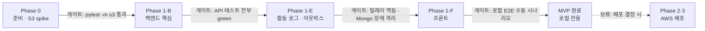

# 이미지 업로드 시스템 — 로드맵

- 작성일: 2026-10-11
- 설계 근거: [`image-upload-adr.md`](./image-upload-adr.md)
- 범위: 로컬 개발 전용(ADR-014). AWS는 S3·IAM·Budgets만 씁니다. Phase 2·3은 보류입니다.

---

## 작업 규칙 (모든 Phase 공통)

이 규칙은 ADR-010에서 정한 것이며, 예외 없이 적용합니다.

1. **비즈니스 로직은 Red → Green → Refactor 사이클로만 추가합니다.**
   - **Red:** 아래 체크리스트의 테스트를 하나 작성하고 실행합니다. **기대한 이유로** 실패하는지 확인합니다.
   - **Green:** 그 테스트를 통과시키는 최소한의 코드만 씁니다. 전체 테스트가 green이어야 합니다.
   - **Refactor:** green 상태에서만 구조를 정리합니다. 동작은 바꾸지 않고, 전체 테스트를 다시 실행합니다.
2. **테스트 없이 비즈니스 로직을 추가하지 않습니다.**
   - 체크리스트에 없는 동작이 필요하면, 먼저 테스트 항목을 이 문서에 추가한 뒤 사이클을 돕니다.
3. **버그 수정도 재현 테스트(Red)부터 시작합니다.**
4. **커밋 단위:**
   - Red와 Green은 하나의 `test+feat`(또는 `test+fix`) 커밋으로 묶습니다.
   - Refactor는 별도 `refactor` 커밋으로 남깁니다.
5. **체크박스 하나가 사이클 하나입니다.**
   - 각 작업 끝의 "Refactor 체크포인트"에서 그 작업 전체를 한 번 정리합니다.
6. **CI 게이트:** 변경된 비즈니스 로직 라인의 커버리지가 100%가 아니면 머지하지 않습니다.
   - 백엔드: `diff-cover`
   - 프론트: Vitest coverage
7. **spike 코드는 `spikes/`에서만 작성하고 머지하지 않습니다.**

---

## 전체 흐름



| Phase | 목표 | 완료 게이트 |
| --- | --- | --- |
| 0 | 리포 골격, S3 버킷, S3 동작 확인 | `terraform test` 통과, `pytest -m s3` 통과 |
| 1-B | 업로드·검증·다운로드·삭제·배치 API | 백엔드 테스트 전부 green, diff-cover 100% |
| 1-E | 이벤트 아웃박스, 릴레이, MongoDB 인덱스, IP 추출, 통계 API | MongoDB를 멈춘 상태에서 1-B 테스트 전부 green, 릴레이 재개 후 누락 없음 |
| 1-F | 업로드 화면, 내 목록, 다운로드, 삭제 | Vitest 전부 green + 실제 dev 버킷 수동 시나리오 |
| 2 (보류) | ECS·RDS·ALB 배포 | ALB 경유 API 동작, `terraform destroy` → `apply` 재현 |
| 3 (보류) | CloudFront, 스케줄러, 권한 정리, 관측 | 배포 도메인에서 Phase 1 시나리오 통과, 배치 실행 이력 확인 |

---

## Phase 0 — 준비와 S3 spike

### 0-1. 리포 골격

리포 구조는 다음과 같습니다.

- `backend/`: uv, Django 5.2, DRF, pytest-django, factory_boy, time-machine, moto, pymongo
  - 개발 도구: ruff, import-linter(ADR-015 계약은 `backend/pyproject.toml`에 설정)
- `frontend/`: Vite + React + TS, Vitest, React Testing Library, MSW
- `infra/`: Terraform
- `docker-compose.yml`: Postgres, MongoDB (ADR-011)

CI는 GitHub Actions로 다음을 구성합니다.
- 백엔드 테스트(Postgres·MongoDB 서비스 컨테이너)
- `ruff check`, `ruff format --check`, `lint-imports`
- Vitest
- `terraform validate`
- diff-cover 게이트

완료 기준: 빈 프로젝트에서 위 CI가 전부 통과합니다.

- [x] 골격 작성, 로컬에서 CI와 같은 명령 전부 통과 (2026-10-11)
- [x] 첫 push 후 GitHub Actions 통과 (기준 브랜치: `prod`, 2026-10-11)

### 0-2. Terraform: S3 버킷 + 로컬 개발용 IAM + 비용 알림 (ADR-014)

state는 로컬 파일로 두고 gitignore합니다.

`terraform test` / checkov로 먼저 단언합니다.

- 단언: `infra/tests/security.tftest.hcl`(mock provider, AWS 자격 증명 불필요)
- 리소스 타입 허용 목록: `infra/scripts/check_resource_types.sh`(정적 검사)
- 각 단언은 설정을 일부러 깨뜨렸을 때 실패하는 것을 확인했습니다(2026-10-12).

- [x] Block Public Access 4개 설정이 모두 켜져 있다
- [x] Versioning이 꺼져 있다: `aws_s3_bucket_versioning` 리소스 자체를 금지(허용 목록 스크립트). 한 번 켜면 되돌릴 수 없기 때문
- [x] 버킷 정책에 `aws:SecureTransport=false` Deny가 있다
- [x] ACL이 비활성(Bucket owner enforced)이다
- [x] Lifecycle: prefix `attachments/` Expiration 370일, AbortIncompleteMultipartUpload 1일
- [x] CORS: origin `http://localhost:5173`, 메서드 POST만 허용
- [x] dev IAM 권한이 버킷 prefix의 `PutObject`·`GetObject`·`DeleteObject`로 한정된다
- [x] dev IAM에 `s3:prefix=attachments/*`로 제한한 `ListBucket`이 있다 (0-3 spike: 없으면 없는 객체 HeadObject가 403)
- [x] 버킷 암호화가 SSE-S3(`AES256`)다. KMS 고객 관리형 키를 쓰지 않는다
- [x] AWS Budgets: 실제 사용액 $1·$3, 예측 사용액 $3 알림이 있다
- [x] 정의된 리소스가 S3·IAM·Budgets뿐이다: 허용 목록 밖 리소스 타입을 정적으로 금지(plan 대신 `.tf` 검사, 자격 증명 불필요)
- [x] CI infra job에서 위 검사와 checkov 통과
- [x] 실제 계정에 `terraform apply` (관리자 프로파일 준비 후, 사용자 요청 시)
- [x] dev IAM 사용자 액세스 키를 콘솔에서 발급해 `~/.aws`의 `image-upload-dev` 프로파일에 등록, `.env`에 `AWS_PROFILE`·`S3_BUCKET` 반영

AWS 액세스 키는 `~/.aws` 프로파일에만 두고, 리포와 `.env`에 커밋하지 않습니다. Terraform으로 액세스 키를 만들지 않습니다(tfstate에 평문으로 남음).
CI용 OIDC 역할은 nightly `-m s3` 계약 테스트와 함께 0-3에서 다룹니다.

### 0-3. S3 spike → 계약 테스트

1. `spikes/`에서 presigned POST로 수동 업로드해 동작을 확인합니다.
2. 확인된 동작을 `@pytest.mark.s3` 테스트로 고정합니다.

- [x] `test_s3_rejects_body_over_size_limit`: 2,621,440바이트(2.5MiB) 초과 본문은 S3가 거부한다
- [x] `test_s3_rejects_mismatched_content_type`: 정책과 다른 Content-Type은 거부된다
- [x] `test_s3_rejects_expired_post`: 만료된 presigned POST는 403
- [x] `test_s3_cors_preflight_allows_frontend_origin`
- [x] `test_s3_presigned_post_uses_regional_endpoint_and_succeeds`: presign URL 호스트가 리전 엔드포인트이고, 그 URL로 업로드하면 204 (307 회귀 방지, spike 결과로 대체)
- [x] `test_s3_head_missing_object_returns_404`: dev 권한으로 없는 객체 HeadObject는 404 (ADR-003 409 판정 전제)
- [x] `test_s3_object_is_not_publicly_readable`: 인증 없는 GET은 403

완료 기준: `pytest -m s3` 통과. 결과를 ADR-002·006·012에 링크합니다.

---

## Phase 1-B — 백엔드 핵심

### 1-1. 모델과 DB 제약 (ADR-004)

- [x] `test_completed_requires_uploaded_at`: 위반 시 `IntegrityError`
- [x] `test_deleted_at_only_for_completed_or_deleting`: PENDING 상태에 `deleted_at` → `IntegrityError`
- [x] `test_public_id_and_s3_key_are_unique`
- [x] `test_timestamps_are_utc`: 저장·조회 시 tz가 UTC
- [x] Refactor 체크포인트

### 1-2. `StorageGateway` (fake + boto3 어댑터, moto)

- [x] `test_presign_post_returns_url_and_fields`
- [x] `test_head_missing_key_raises_object_not_found`
- [x] `test_read_prefix_requests_range_0_7`
- [x] `test_open_returns_stream_and_content_type`
- [x] `test_open_missing_key_raises_object_not_found`
- [x] `test_delete_missing_key_succeeds`
- [x] `test_delete_failure_raises_storage_error`: S3 오류는 `StorageError`로 매핑 (배치는 key마다 `delete_object`, ADR-005)
- [x] `test_fake_gateway_matches_adapter_contract`: 같은 테스트 세트를 fake와 어댑터 양쪽에 실행
- [x] Refactor 체크포인트

### 1-3. 인증 API

근거: ADR-007 "인증 API". 별도 `accounts` 앱, 경로는 `/api/auth/*`(끝 슬래시 없음).

- [x] `test_auth_user_model_is_custom`: `AUTH_USER_MODEL == "accounts.User"`
- [x] `test_api_urls_have_no_trailing_slash`
- [x] `test_csrf_endpoint_sets_cookie`
- [x] `test_login_creates_session`
- [x] `test_inactive_user_gets_same_invalid_credentials_response`: 없는 아이디·틀린 비밀번호·비활성 사용자 모두 400 `invalid credentials`
- [x] `test_login_rotates_csrf_token`
- [x] `test_logout_clears_session`
- [x] `test_logout_rejects_get`: 405
- [x] `test_me_requires_authentication`: 미인증 403
- [x] `test_post_without_csrf_is_rejected`: 로그인(미인증)·로그아웃(인증) parametrize, `APIClient(enforce_csrf_checks=True)`, JSON 403
- [x] Refactor 체크포인트

### 1-4. `POST /api/attachments/presign`

- [x] `test_presign_requires_authentication`
- [x] `test_presign_rejects_too_many_files`: 400
- [x] `test_presign_rejects_disallowed_type`: `image/heic`, `image/svg+xml` → 400
- [x] `test_presign_rejects_oversized_file`: 400
- [x] `test_presign_rejected_request_creates_no_rows`: 유효 1장 + HEIC 1장 → 400, 행 0개
- [x] `test_presign_rejects_invalid_filename`: 255자 초과·빈 이름·NUL·줄바꿈 → 400
- [x] `test_presign_creates_pending_per_file`
- [x] `test_presign_policy_contains_size_type_key_conditions`: policy base64 디코딩
- [x] `test_presign_key_extension_matches_mime`: `.png` / `.jpg`
- [x] `test_presign_key_is_scoped_to_user`: `attachments/{user_id}/...`
- [x] `test_presign_response_echoes_client_ref_with_public_id`: 201, `s3_key`·버킷 필드 없음
- [x] `test_presign_throttled_after_limit`: 429
- [x] Refactor 체크포인트

### 1-5. `POST /api/attachments/{public_id}/complete`

- [ ] `test_complete_forbidden_for_other_user`: 403
- [ ] `test_complete_missing_object_returns_409_and_stays_pending`
- [ ] `test_complete_png_signature_marks_completed`: `uploaded_at` 기록
- [ ] `test_complete_jpeg_signature_marks_completed`
- [ ] `test_complete_mismatched_signature_rejects_and_deletes_object`
- [ ] `test_complete_is_idempotent`: 두 번째 호출 200
- [ ] `test_complete_response_has_no_s3_key_or_url`
- [ ] Refactor 체크포인트

### 1-6. `GET /api/attachments` (내 목록)

- [ ] `test_list_returns_only_own_attachments`
- [ ] `test_list_excludes_pending_rejected_deleting`
- [ ] `test_list_excludes_soft_deleted`
- [ ] `test_list_ordered_by_uploaded_at_desc`
- [ ] `test_list_items_expose_only_public_fields`: `public_id`, `original_filename`, `uploaded_at`
- [ ] `test_list_response_has_no_s3_key_bucket_or_s3_domain`
- [ ] Refactor 체크포인트

### 1-7. `GET /api/attachments/{public_id}/download` (ADR-012)

- [ ] `test_download_forbidden_for_other_user`: 403
- [ ] `test_download_soft_deleted_returns_404`
- [ ] `test_download_pending_returns_404`
- [ ] `test_download_streams_object_bytes`: 응답 본문 = 객체 바이트
- [ ] `test_download_sets_attachment_disposition_with_original_filename`: 한글 파일명 `filename*`
- [ ] `test_download_sets_content_type_from_object`
- [ ] `test_download_sets_nosniff_and_no_store`
- [ ] `test_download_missing_object_returns_404_and_logs_warning`
- [ ] `test_download_response_has_no_redirect_or_s3_url`: 3xx 아님, 헤더·본문에 S3 도메인 없음
- [ ] Refactor 체크포인트

### 1-8. `DELETE /api/attachments/{public_id}` (소프트 삭제)

- [ ] `test_soft_delete_forbidden_for_non_uploader`: 403
- [ ] `test_soft_delete_sets_deleted_at`
- [ ] `test_soft_delete_does_not_call_storage`
- [ ] `test_soft_delete_is_idempotent`
- [ ] Refactor 체크포인트

### 1-9. 하드 삭제 서비스 `purge()`

- [ ] `test_purge_marks_deleting_and_writes_log_before_storage_call`
- [ ] `test_purge_log_copies_uploaded_at_and_deleted_at`
- [ ] `test_purge_deletes_object_then_row`
- [ ] `test_purge_storage_failure_keeps_deleting_row`
- [ ] `test_purge_records_requested_by_for_ops`
- [ ] Refactor 체크포인트

### 1-10. `manage.py attachment_maintenance` (time-machine)

- [ ] `test_pending_older_than_24h_with_valid_object_is_completed`
- [ ] `test_pending_older_than_24h_without_object_is_purged`
- [ ] `test_pending_younger_than_24h_is_untouched`
- [ ] `test_rejected_rows_are_purged`
- [ ] `test_soft_deleted_30_days_is_purged`
- [ ] `test_soft_deleted_29_days_is_kept`
- [ ] `test_uploaded_365_days_is_purged`
- [ ] `test_uploaded_364_days_is_kept`
- [ ] `test_leftover_deleting_rows_are_retried`
- [ ] `test_purge_keeps_rows_deleting_when_s3_delete_fails`: 삭제 실패한 key의 행만 `DELETING`으로 남음
- [ ] `test_concurrent_runs_do_not_double_process`: Postgres + 스레드 2개, `skip_locked`
- [ ] Refactor 체크포인트

### 1-11. `manage.py purge_attachment --id`

- [ ] `test_purge_command_hard_deletes_immediately`
- [ ] `test_purge_command_records_operator`
- [ ] `test_purge_command_unknown_id_fails_cleanly`
- [ ] Refactor 체크포인트

**Phase 1-B 게이트:** 백엔드 테스트 전부 green, diff-cover 100%, views에 비즈니스 분기 없음

---

## Phase 1-E — 활동 로그 (MongoDB + 아웃박스, ADR-013)

1-B에서 만든 서비스에 이벤트 기록을 덧붙입니다. 기존 테스트는 그대로 green을 유지해야 합니다.

### 1-18. 클라이언트 IP 추출

- [ ] `test_client_ip_uses_remote_addr_when_no_trusted_proxy`
- [ ] `test_client_ip_counts_trusted_hops_from_right`
- [ ] `test_client_ip_ignores_spoofed_leftmost_xff`
- [ ] `test_client_ip_with_fewer_xff_entries_than_hops_falls_back_safely`
- [ ] `test_client_ip_invalid_value_becomes_null`
- [ ] `test_client_ip_supports_ipv6`
- [ ] Refactor 체크포인트

### 1-19. 아웃박스 기록 (같은 트랜잭션)

- [ ] `test_complete_writes_upload_completed_event`
- [ ] `test_reject_writes_upload_rejected_event`
- [ ] `test_download_writes_downloaded_event_with_ip_and_user_agent`
- [ ] `test_download_denied_writes_no_event`: 403·404에서는 기록하지 않음
- [ ] `test_soft_delete_writes_soft_deleted_event`
- [ ] `test_purge_by_batch_writes_purged_event_with_null_ip`
- [ ] `test_purge_by_ops_writes_requested_by`
- [ ] `test_event_rolled_back_with_business_transaction`: 상태 변경이 롤백되면 이벤트도 남지 않음
- [ ] `test_request_path_never_calls_mongo`: 요청 처리 중 MongoDB 클라이언트 호출 없음
- [ ] Refactor 체크포인트

### 1-20. MongoDB 인덱스 (`manage.py ensure_mongo_indexes`, 실제 MongoDB)

- [ ] `test_creates_unique_event_id_index`
- [ ] `test_creates_ttl_index_400_days_on_occurred_at`
- [ ] `test_creates_user_and_attachment_lookup_indexes`
- [ ] `test_ensure_indexes_is_idempotent`
- [ ] Refactor 체크포인트

### 1-21. 릴레이 (`manage.py relay_events`, 실제 MongoDB)

- [ ] `test_relay_publishes_unpublished_events_and_marks_published`
- [ ] `test_relay_skips_already_published_rows`
- [ ] `test_relay_treats_duplicate_event_id_as_success`: 11000 → 성공 처리
- [ ] `test_relay_keeps_rows_unpublished_when_mongo_down`
- [ ] `test_relay_respects_batch_size`
- [ ] `test_concurrent_relays_do_not_select_same_rows`: `skip_locked`
- [ ] `test_relay_document_matches_schema`: `occurred_at` UTC, 시스템 이벤트의 `ip`·`user_agent`는 null
- [ ] Refactor 체크포인트

### 1-22. 아웃박스 정리 (`attachment_maintenance`에 추가)

- [ ] `test_published_outbox_rows_older_than_7_days_are_deleted`
- [ ] `test_published_outbox_rows_younger_than_7_days_are_kept`
- [ ] `test_unpublished_outbox_rows_are_never_deleted`
- [ ] Refactor 체크포인트

### 1-23. 통계 API `GET /api/attachments/stats?days=30`

- [ ] `test_stats_requires_authentication`
- [ ] `test_stats_counts_only_own_events`
- [ ] `test_stats_buckets_by_utc_day`
- [ ] `test_stats_respects_days_parameter_and_upper_bound`
- [ ] `test_stats_response_has_no_ip_or_user_agent`
- [ ] `test_stats_returns_503_when_mongo_down`
- [ ] Refactor 체크포인트

**Phase 1-E 게이트:**
- MongoDB 컨테이너를 멈춘 상태에서 1-B 테스트가 전부 green입니다(장애 격리).
- MongoDB를 다시 띄우고 릴레이를 돌리면, 멈춘 동안 쌓인 이벤트가 누락 없이 적재됩니다.

---

## Phase 1-F — 프론트

### 1-12. 셋업

- Vite + React + TS
- `/api` proxy
- TanStack Query
- axios 인스턴스(CSRF 헤더)
- [ ] `reads csrf token from cookie on every request`: 로그인 후 토큰이 바뀌어도 다음 POST에 새 토큰이 실림(ADR-007)

### 1-13. 사전 검증

- [ ] `rejects file over size limit without calling presign`
- [ ] `rejects disallowed mime type without calling presign`
- [ ] `accepts png and jpeg within limit`
- [ ] Refactor 체크포인트

### 1-14. 업로드 큐 reducer (`useReducer`)

- [ ] `queued → presigning → uploading → confirming → done`
- [ ] `progress event updates only the target file`
- [ ] `403 clears presign and retries`
- [ ] `400 moves to fatal failed`
- [ ] `network error retries with backoff up to 4 times`
- [ ] `exhausted retries move to retryable failed`
- [ ] `cancel moves uploading file to cancelled`
- [ ] Refactor 체크포인트

### 1-15. 동시성 풀

- [ ] `never runs more than limit tasks at once`: deferred promise fake uploader
- [ ] `one failure does not stop other tasks`
- [ ] `resolves after all tasks settle`
- [ ] Refactor 체크포인트

### 1-16. 업로드 화면 (React Testing Library + MSW)

- [ ] `selecting files shows per-file progress and done state`
- [ ] `retry failed only resends failed files`
- [ ] `cancel aborts in-flight uploads`
- [ ] `oversized file shows guidance message`
- [ ] Refactor 체크포인트

### 1-17. 내 목록·다운로드·삭제

- [ ] `list renders public fields only`
- [ ] `download calls download endpoint, never an s3 url`
- [ ] `delete removes item from list immediately`: 쿼리 무효화
- [ ] Refactor 체크포인트

### 1-17a. (선택) 내 통계 화면

- [ ] `renders daily counts from stats endpoint`
- [ ] `shows fallback message on 503`
- [ ] Refactor 체크포인트

**Phase 1-F 게이트:** Vitest 전부 green. 실제 dev 버킷으로 다음 시나리오를 수동 확인합니다.
- 다중 업로드 → 목록 → 다운로드 → 삭제
- 브라우저 네트워크 탭에 S3 읽기 URL이 없음
- Vite proxy 경유 로그인·업로드가 `Origin checking failed` 403 없이 동작함(`CSRF_TRUSTED_ORIGINS`, ADR-007)

---

## 로컬 실행 절차 (MVP 운영 방식)

```bash
docker compose up -d                                  # Postgres, MongoDB
cd backend && uv run python manage.py migrate
uv run python manage.py createcachetable              # presign throttle용 DatabaseCache
uv run python manage.py ensure_mongo_indexes
uv run python manage.py runserver                     # API (TRUSTED_PROXY_HOPS=0)
uv run python manage.py relay_events --loop           # 별도 터미널: 아웃박스 → MongoDB
cd frontend && npm run dev                            # Vite, /api proxy
uv run python manage.py attachment_maintenance        # 필요할 때 수동 실행
```

- **비밀값:** `.env`(gitignore)에 둡니다.
- **AWS 자격 증명:** `AWS_PROFILE`로 로컬 개발용 IAM 프로파일을 지정합니다.
- **배치 시간 규칙(24h, 30일, 1년)은 테스트에서 time-machine으로 검증합니다.** 로컬에서 실제로 며칠씩 기다릴 필요는 없습니다.

---

## Phase 2 — AWS 배포 (보류, ADR-014)

> 배포를 결정하면 이 단계를 시작합니다. 그때는 임시 스택(apply/destroy), NAT Gateway 없음, ARM64 Fargate를 기준으로 다시 검토합니다. 예산 기준은 월 $5, 약 45시간입니다.

인프라 작업이므로 비즈니스 로직 TDD 대상이 아닙니다. 보안 설정만 `terraform test`로 단언합니다.

**Terraform 구성:**
- VPC
- RDS PostgreSQL
- ECR
- ECS Fargate 서비스
- ALB
- ECS 태스크 롤

**단언할 보안 설정:**
- [ ] 태스크 롤 권한이 버킷 prefix로 한정된다
- [ ] RDS가 public 접근 불가
- [ ] 보안 그룹: ALB → ECS → RDS만 허용

**그 밖의 작업:**
- **비밀값:** DB 비밀번호, `SECRET_KEY`, MongoDB 접속 URI는 SSM Parameter Store 또는 Secrets Manager에 둡니다.
- **이미지:** Django 이미지(gunicorn) 하나를 만들고, 마이그레이션과 `ensure_mongo_indexes`는 같은 이미지의 일회성 ECS 태스크로 실행합니다.
- **MongoDB:**
  - MongoDB Atlas 클러스터를 생성합니다(기본안: 무료 티어).
  - ECS egress 방식을 정합니다. NAT Gateway 또는 public subnet + Atlas IP 접근 목록 중 하나입니다.
- **이벤트 릴레이:** 같은 이미지로 ECS 서비스를 만들고(태스크 1개), 커맨드는 `manage.py relay_events --loop`입니다.
- **CI/CD:** GitHub Actions로 테스트 → 이미지 빌드·푸시 → 서비스 갱신 순서로 배포합니다. AWS 인증은 OIDC로 합니다.

**Phase 2 게이트:**
- ALB 경유로 Phase 1 API가 동작합니다.
- `terraform destroy` → `apply`로 재현됩니다.
- `pytest -m s3`가 배포 리전에서 통과합니다.

---

## Phase 3 — 마무리 (보류, ADR-014)

- **CloudFront:** SPA(S3) origin과 `/api/*`(ALB) origin을 둡니다. `CSRF_TRUSTED_ORIGINS`와 버킷 CORS를 배포 도메인으로 갱신합니다.
- **EventBridge Scheduler:** ECS RunTask로 `attachment_maintenance`를 하루 1회 실행합니다.
- **break-glass 역할:** 역할을 추가하고, 개발자 기본 권한에서 운영 버킷 `DeleteObject`를 제거합니다.
- **`TRUSTED_PROXY_HOPS` 확정:** CloudFront → ALB 경유 요청의 `X-Forwarded-For`를 실제로 확인해 값을 정합니다.
  - 그 구성을 재현하는 `test_client_ip_behind_cloudfront_and_alb`를 추가합니다(Red → Green).
- **관측 알람:**
  - 업로드 실패율
  - `PENDING` 잔량
  - `DELETING` 정체 건수
  - 다운로드 5xx
  - 아웃박스 미발행 건수와 가장 오래된 미발행 이벤트의 대기 시간(릴레이 정지 감지)
- **(선택) Playwright E2E:** 업로드 → 다운로드 해피 패스

**Phase 3 게이트:**
- 배포 도메인에서 Phase 1 시나리오가 통과합니다.
- 배치 실행 이력이 CloudWatch Logs에 남습니다.
